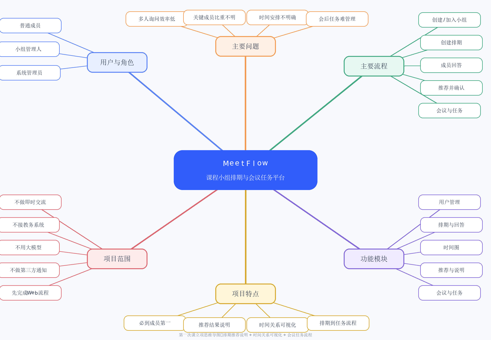

# MeetFlow 项目立项会议记录

## 1. 会议基本信息

| 项目 | 内容 |
| --- | --- |
| 会议主题 | 软件工程课程设计第一次立项与头脑风暴会议 |
| 时间 | `[会议时间]` |
| 地点 | `[会议地点]` |
| 主持人 | `[待填写]` |
| 记录人 | `[待填写]` |
| 参会者 | `[组员A]`、`[组员B]`、`[组员C]`、`[组员D]` |
| 项目仓库 | `[仓库地址]` |

## 2. 会议目标

1. 围绕真实用户需求开展头脑风暴；
2. 比较候选题目的实现难度、工程完整度和展示效果；
3. 确定课程设计题目、目标用户和核心业务流程；
4. 明确第一阶段交付物和初步分工；
5. 确定项目不实现的内容，控制开发风险。

## 3. 头脑风暴候选方案

### 3.1 MeetFlow：课程小组协作排期与会议闭环平台

面向课程小组、学生社团和临时项目团队。成员填写候选时间段的空闲状态，系统综合必到成员、普通成员和时间偏好，自动推荐冲突最少的时间。会议确定后继续记录纪要、分配任务并跟踪完成情况。

### 3.2 ShelfWise：宿舍临期食品与库存助手

记录宿舍食品、饮品和日用品的数量、开启时间与保质期，提供临期提醒、共享库存、采购清单和浪费统计。

### 3.3 SprintStudy：考前冲刺规划与复盘平台

根据考试日期、章节重要度、掌握程度和可用学习时间生成每日复习计划，并支持错题、完成度和复盘记录。

## 4. 候选方案比较

评分采用 1 至 5 分，5 分表示更符合课程设计目标。评分为小组讨论结论，不代表教师官方评分。

| 评价维度 | 权重 | MeetFlow | ShelfWise | SprintStudy |
| --- | ---: | ---: | ---: | ---: |
| 实现可控性 | 25% | 4 | 5 | 4 |
| 需求与设计材料丰富度 | 25% | 5 | 4 | 4 |
| 展示效果 | 20% | 5 | 4 | 4 |
| 功能创意 | 15% | 4 | 4 | 4 |
| 真实用户反馈可获得性 | 15% | 5 | 5 | 5 |
| 加权结果 | 100% | **4.60** | **4.40** | **4.15** |

## 5. 最终选题

小组决定选择：

> **MeetFlow（凑时）——面向课程小组的协作排期与会议闭环平台**

### 5.1 选择理由

1. **痛点真实**：学生团队经常需要通过群聊反复确认时间，消息零散且结论不透明；
2. **业务闭环清晰**：能够形成排期、确认、开会、记录、任务跟踪的完整流程；
3. **工程材料丰富**：适合完成用例图、活动图、状态图、时序图、ER图和系统架构设计；
4. **实现风险可控**：主要功能由权限控制、数据管理、统计展示和确定性评分算法构成；
5. **展示效果较好**：成员时间矩阵、热力图、推荐解释和任务看板适合现场演示；
6. **容易获得反馈**：可以邀请其他课程小组、社团或同学直接试用。

## 6. 目标用户与初步痛点

### 6.1 目标用户

- 需要安排讨论时间的课程项目组；
- 需要多人共同参与活动的学生社团；
- 需要临时协调时间的比赛或科研团队。

### 6.2 用户痛点

- 群聊逐人询问效率低，消息容易被覆盖；
- 简单投票无法体现必到成员的重要性；
- 缺少统一、直观的时间冲突视图；
- 最终时间确定后，成员可能遗漏结论；
- 会议纪要和会后任务与排期相互割裂；
- 缺少任务负责人、截止日期和完成状态的持续跟踪。

## 7. 初步核心流程

```text
创建账号和小组
  → 发起排期并设置候选时间
  → 邀请成员填写空闲状态
  → 系统计算并解释推荐结果
  → 发起人确认会议
  → 记录会议纪要
  → 创建、分配和跟踪任务
```

## 8. 初步功能讨论结果

### 8.1 第一版必须完成

- 用户注册、登录和退出；
- 创建小组、邀请码加入小组、成员管理；
- 创建排期、设置候选时间段和填写空闲状态；
- 区分必到成员与普通成员；
- 推荐时间计算、冲突展示和推荐原因说明；
- 发起人确认会议；
- 会议纪要和任务分配；
- 个人待办和小组任务状态查看。

### 8.2 视进度增加

- 结果导出为图片；
- 小组会议和任务统计图；
- 站内提醒；
- 历史排期复用。

### 8.3 第一版明确不做

- 即时聊天；
- 微信、QQ或短信推送；
- 大模型自动总结；
- 与学校教务系统对接；
- 支付和商业化功能；
- 原生移动端应用。

## 9. 初步人员分工

分工将在需求确定后继续细化，最终贡献比例按实际工作计算。

| 成员 | 初步职责 |
| --- | --- |
| `[组员A]` | 项目管理、需求分析、文档整合、系统集成 |
| `[组员B]` | 前端页面、交互原型、时间矩阵与可视化 |
| `[组员C]` | 后端接口、身份权限、排期推荐算法 |
| `[组员D]` | 数据库设计、自动化测试、部署与用户反馈 |

## 10. 初步风险及应对

| 风险 | 影响 | 应对方式 |
| --- | --- | --- |
| 功能不断增加 | 无法按时完成 | 以 `03-需求边界与MVP.md` 为范围基线 |
| 多人开发产生冲突 | 代码合并困难 | 按模块建分支，通过 Pull Request 合并 |
| 推荐算法不透明 | 用户不信任结果 | 展示得分构成、必到成员冲突和推荐原因 |
| 部署环境不稳定 | 最终无法演示 | 优先保证本地一键运行，并准备录屏和测试账号 |
| 文档与实现不一致 | 影响需求和设计评分 | 每个里程碑结束时同步更新文档 |

## 11. 思维导图



## 12. 会议照片

> 请将真实会议照片保存为 `Docs/images/立项会议照片.jpg`，然后删除本提示。


## 13. 会后行动项

| 行动项 | 负责人 | 截止时间 | 状态 |
| --- | --- | --- | --- |
| 创建并初始化 Gitee 仓库 | `[待填写]` | `[待填写]` | 待完成 |
| 完成立项会议记录 | `[待填写]` | `[待填写]` | 进行中 |
| 核对 NABCD 分析 | `[待填写]` | `[待填写]` | 进行中 |
| 调整并导出思维导图 | `[待填写]` | `[待填写]` | 待完成 |
| 调研同学排期习惯 | `[待填写]` | `[待填写]` | 待完成 |
| 准备快速原型 | `[待填写]` | `[待填写]` | 待完成 |

## 14. 会议结论

全体成员同意以 MeetFlow 为课程设计题目，首先完成立项材料和需求边界确认。后续开发以核心排期流程为主线，任务管理作为会议闭环的重要组成部分，所有扩展功能必须在 MVP 稳定后再考虑。
