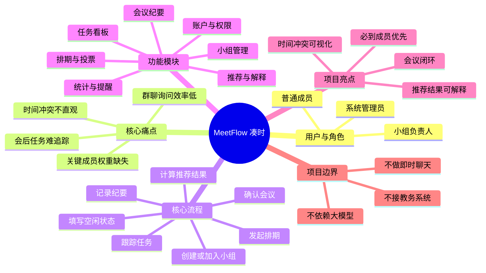

# MeetFlow 思维导图

## 1. 导出图片


图片可以直接用于 Gitee Wiki 和立项会议记录。`images/MeetFlow-思维导图.dot` 是可编辑源文件；如果小组使用 ProcessOn，也可以根据下方节点重新绘制并替换 PNG。

## 2. ProcessOn 节点结构

```text
MeetFlow（凑时）
├── 用户与角色
│   ├── 游客
│   ├── 普通成员
│   ├── 小组负责人
│   └── 系统管理员
├── 核心痛点
│   ├── 群聊询问效率低
│   ├── 关键成员权重缺失
│   ├── 时间冲突不直观
│   ├── 会议结论易遗漏
│   └── 会后任务难追踪
├── 核心流程
│   ├── 创建或加入小组
│   ├── 发起排期
│   ├── 填写空闲状态
│   ├── 计算推荐结果
│   ├── 确认会议
│   ├── 记录会议纪要
│   └── 分配并跟踪任务
├── 功能模块
│   ├── 账户与权限
│   ├── 小组管理
│   ├── 排期管理
│   ├── 时间矩阵与热力图
│   ├── 推荐与解释
│   ├── 会议纪要
│   ├── 任务看板
│   └── 统计与提醒
├── 技术实现
│   ├── Vue 3 前端
│   ├── FastAPI 后端
│   ├── SQLite/PostgreSQL
│   ├── 确定性评分算法
│   ├── REST API
│   └── 自动化测试
├── 项目亮点
│   ├── 必到成员优先
│   ├── 推荐结果可解释
│   ├── 时间冲突可视化
│   └── 排期到任务闭环
└── 项目边界
    ├── 不做即时聊天
    ├── 不做第三方消息推送
    ├── 不接教务系统
    ├── 不依赖大模型
    └── 先保证Web端完整流程
```

## 3. Mermaid 备份源码

如果使用的 Markdown 平台能够渲染 Mermaid，可以保留以下内容；不能渲染时使用上方 PNG。


