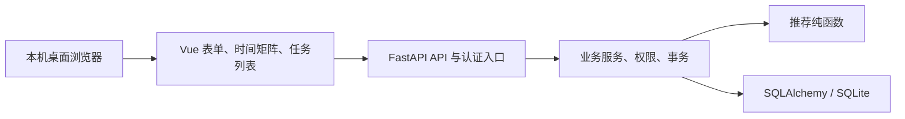

# MeetFlow 系统设计速查

整理基线：B1｜2026-10-25。完整设计统一维护在[系统设计文档 V1.0](12-系统设计文档.md)，对应[需求分析 V1.2](09-需求分析文档.md)。本页用于开发导航，不重复维护全部字段、接口和算法定义。

## 1. 架构与运行

模块化单体、单进程；交付时由127.0.0.1上的同一服务提供前端静态文件和`/api/v1`，无外部业务服务依赖。开发时使用前端代理；首版不部署PostgreSQL或公网服务。

## 2. 已确定的设计

| 决策 | 实现要点 | 完整定义 |
| --- | --- | --- |
| 会话 | 服务端可撤销会话；Cookie传递随机令牌，数据库存摘要；退出撤销当前会话 | 12号文档API-01、IN-01 |
| 负责人 | 以groups.owner_id为唯一依据；成员接口导出OWNER/MEMBER，无额外管理员字段 | DT-03、DT-04 |
| 草稿与冻结 | 草稿整体保存；发布后禁止修改时段和参与者；时间截止在服务端写事务内复核 | API-04～06、FL-02/03 |
| 推荐 | 不落库，按当前答案计算；未填贡献、权重、排序以09号第5节为准 | IN-04、API-07 |
| 确认会议 | 一个poll只对应一个meeting，UNIQUE(poll_id)配合事务；同slot重试返回原会议 | DT-09、API-08 |
| 任务重试 | client_request_id防止重复创建；同一标识不同正文返回冲突 | DT-10、API-10 |
| 并发 | SQLite短写事务、取得写锁后再检查截止和状态；写锁失败给出可恢复错误 | 12号第4.4节 |
| 时间 | UTC毫秒整数存储；带时区RFC3339输入，响应Z后缀；页面显示北京时间 | 12号第4.2节 |

必到成员未提交、全部候选冲突及非首选确认都必须解释清楚。会话到期、角色不足、对象跨组、截止、重复请求等情况不能只靠前端按钮限制。

## 3. 数据对象

| 对象 | 作用 | 关键关系 |
| --- | --- | --- |
| users | 用户与密码哈希 | 用户名、邮箱唯一 |
| sessions | 会话有效期与撤销 | 令牌摘要唯一，关联用户 |
| groups | 小组及邀请码 | owner_id关联用户 |
| group_members | 小组成员 | (group_id,user_id)唯一 |
| polls | 排期主题、截止与状态 | 属于小组 |
| participants | 本次参与者及重要程度 | 参与者必须是组内成员 |
| slots | 候选时间 | 同排期起止组合唯一 |
| votes | 三态答案 | 同slot、user唯一，属于同一排期 |
| meetings | 确认结果、理由、议程与纪要 | poll_id唯一，来源slot与小组一致 |
| tasks | 任务执行人、截止与状态 | 执行人属于组；去重键唯一 |

完整字段、外键、索引和ER图以12号第4节为准。第一版不含notifications、独立记录人授权、额外会议状态、任务CANCELLED及历史物理删除接口。

## 4. API 与页面导航

| 流程 | API组 | 页面 | 主要权限 |
| --- | --- | --- | --- |
| 注册、登录、退出 | API-01 | 登录/注册 | 本人会话 |
| 建组、入组、邀请码 | API-02、API-03 | 小组列表与详情 | 登录用户，邀请码重置限负责人 |
| 草稿、发布、关闭、取消 | API-04、API-05 | 排期编辑与详情 | 负责人操作，组员查看 |
| 本人填写 | API-06 | 空闲状态填写 | 本次参与者 |
| 矩阵、推荐、确认 | API-07、API-08 | 排期结果 | 组员查看，负责人确认 |
| 议程与纪要 | API-09 | 会议详情 | 组员查看，负责人编辑 |
| 任务创建、进度和待办 | API-10、API-11 | 会议任务列表、个人待办 | 负责人创建；负责人或执行人改状态 |
| 首页汇总（P1） | API-12 | 可选工作台 | 当前用户 |
| 健康检查 | API-13 | 无独立业务页 | 本地诊断 |

接口路径、请求响应、错误码以12号第5节为准。页面可合并，例如会议详情包含纪要和任务列表；不为了文档中的模块数增加页面。

## 5. 验证与维护

开发时按“MF需求 → API/DT设计 → AC验收/TV验证”追踪。完整矩阵与16项TV在12号第11、12节，[07](07-验收标准与测试计划.md)提供阶段验收入口。

业务范围发生变化时先更新09及03，设计变化更新12及本页相关入口，再记录到[版本与变更记录](13-版本与变更记录.md)。只改实现内部结构、且不影响需求与接口时，可在Git提交中说明，避免重复抄写技术内容。
