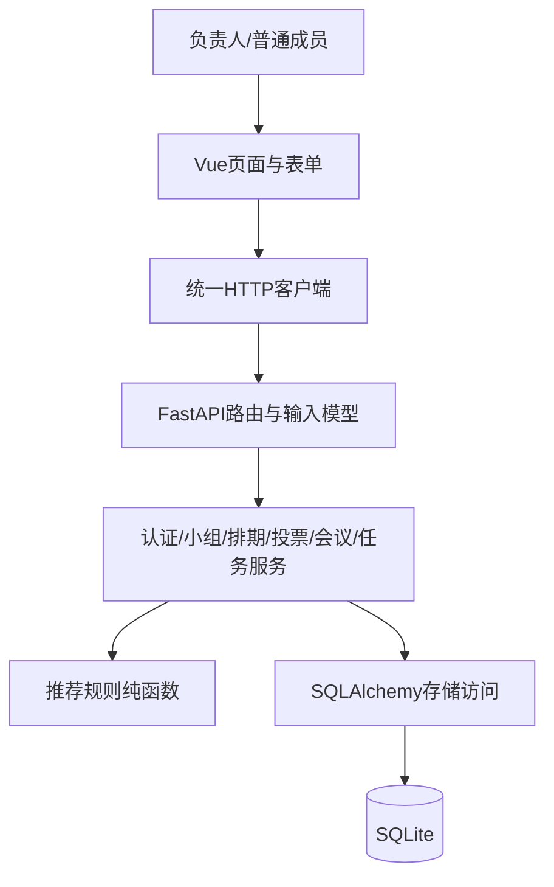
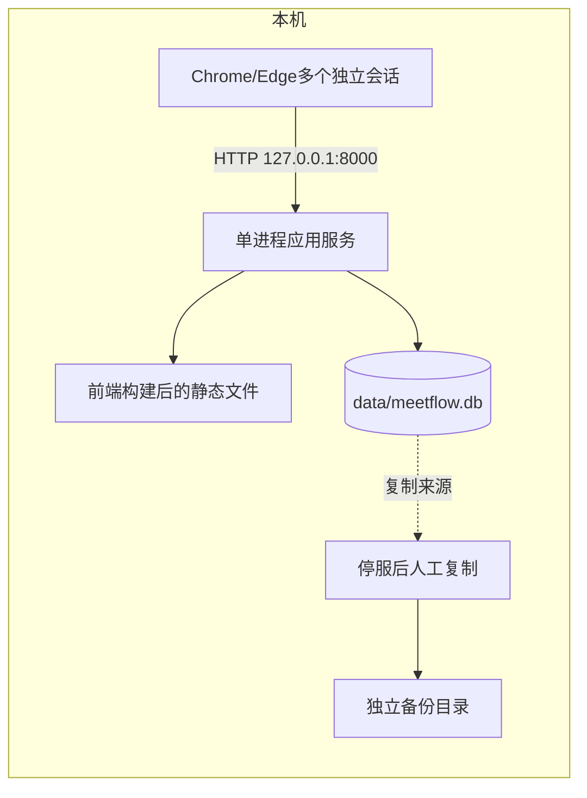
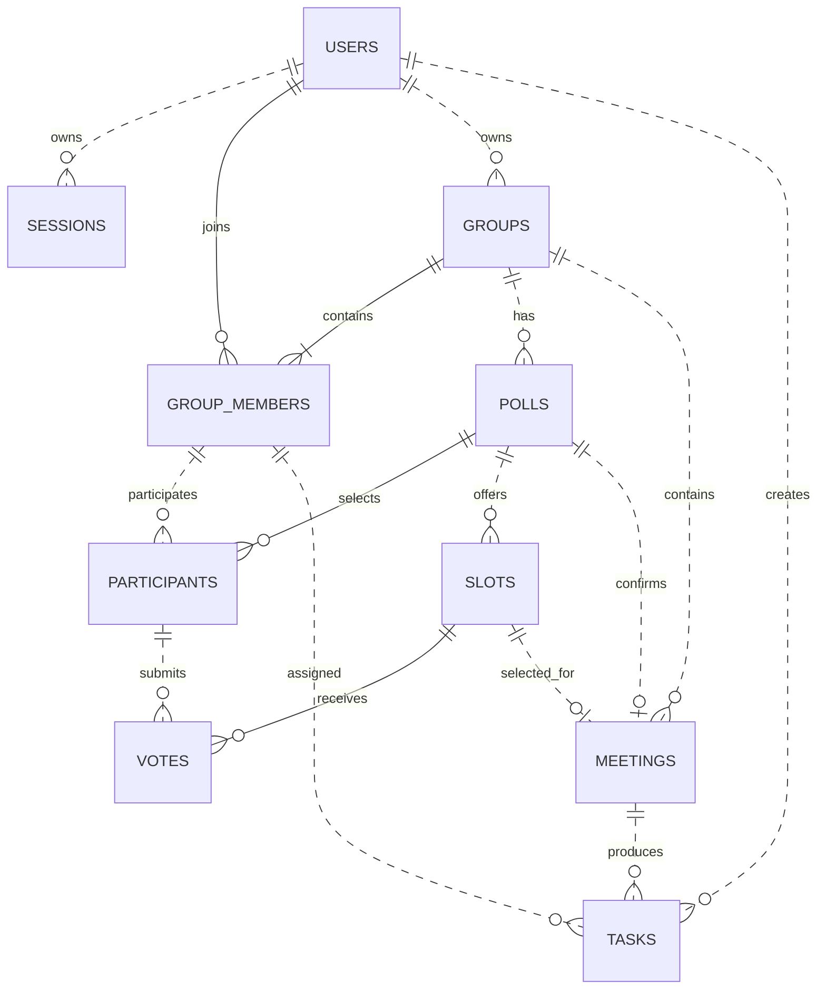
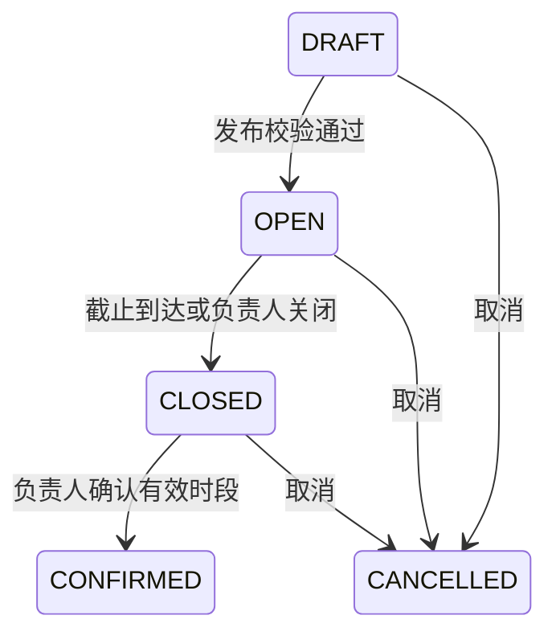
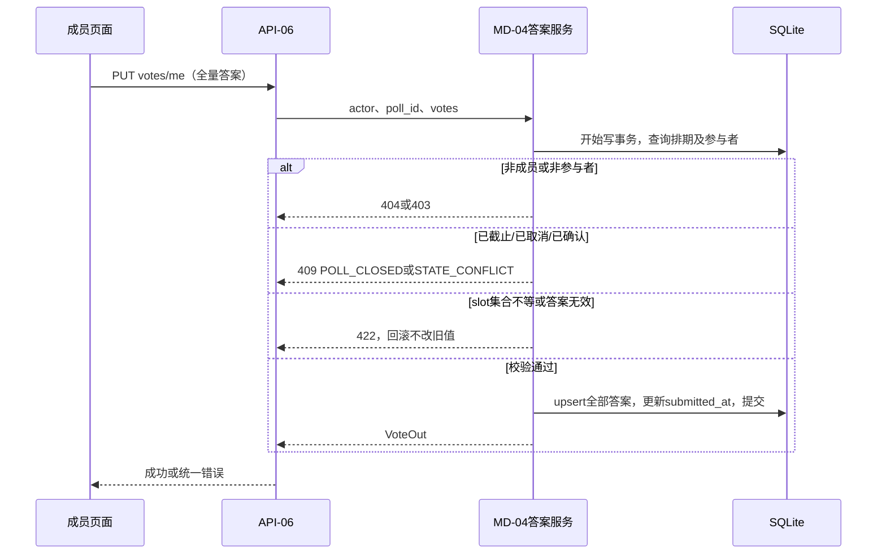

# MeetFlow（凑时）系统设计文档

版本：V1.0｜日期：2026-10-18｜实验：软件系统设计（个人）

T03图示勘误：2026-10-26修正草稿ER最小基数并补齐归属关系，未改变需求或字段契约。完整图集与原型简化项见[15号核对记录](15-设计图与需求原型核对.md)。

## 1. 需求来源、基线与设计范围

### 1.1 需求基线

本设计沿用实验1的[《MeetFlow需求分析文档》V1.2](09-需求分析文档.md)，对应仓库提交 `a50eebe`。核心问题为多人时间信息分散、关键成员冲突难以比较、会议决定与后续任务脱节；目标用户为课程小组负责人和普通成员。设计依据为MF-01～MF-13、可选MF-15及NFR-01～NFR-08，验收编号沿用AC-01～AC-12和E2E-01。MF-14、MF-16不属于该版本基线，不重新启用。

首版范围为账户、小组、候选时间、三态填写、规则推荐、会议确认、纯文本纪要、任务列表与个人待办。每组最多20人，每次排期1～15个时段。采用本地单实例部署，只服务本机浏览器；四账号演示使用不同浏览器会话依次或并行操作，不表示支持其他设备联网访问。

不包含移动适配、公网发布、第三方登录、消息推送、私人日历、自动备份、图表、额外角色、成员退出或转让。设计不增加此类产品需求。

### 1.2 需求变更说明

本次不修改实验1需求，不改变原编号、优先级、容量或验收目标。以下为实现规则细化，不替代需求：

| 设计细化 | 关联需求 | 具体含义 |
| --- | --- | --- |
| 会话保存在服务端 | MF-01、MF-13 | 使用可撤销会话实现退出立即失效 |
| 到期状态按请求计算并在写操作前落库 | MF-05、NFR-07 | 不依赖定时任务，达到截止时刻即禁止填写 |
| 小组负责人由owner_id唯一确定 | MF-02、MF-13 | 不维护第二套可冲突的OWNER角色字段 |
| 草稿整体保存，发布后冻结结构 | MF-03、MF-04 | 候选时间和参与者一次提交，失败整体回滚 |
| 创建任务使用请求去重标识 | MF-11、NFR-05 | 防止网络重试造成重复任务，不增加用户操作 |

后续如需改变成员容量、角色、状态机或允许发布后修改结构，须先建立需求变更记录并同步实验1文档。旧03、05、06、07文档仅作为历史方案，存在冲突时以V1.2基线及本设计为准。

### 1.3 术语与编号

排期poll是候选时间收集活动；时段slot是一组开始/结束时间；参与者participant是本次被选中的小组成员；答案vote是参与者对时段的三态选择；会议meeting是已确认的结果。AVAILABLE=有空，MAYBE=勉强，UNAVAILABLE=没空；未填写由答案缺失表示，不增加第四个可提交值。

设计元素编号：AR为架构，MD为模块，FL为流程，API为HTTP接口，IN为内部接口，DT为实体，UI为界面，NF为非功能设计，EX为异常策略，DD为设计决策，TV为验证场景。

## 2. 架构设计

### 2.1 AR-01 分层与依赖

采用模块化单体，浏览器与服务端通过JSON HTTP通信。后端以路由层、业务服务层、存储层划分，推荐函数独立为纯计算模块。



路由负责解析、认证入口和响应转换；服务负责授权、业务规则与事务；存储层负责查询及持久化，不自行提交事务；推荐模块只接受结构化输入，不读取数据库、不访问网络。服务之间通过显式参数调用，不互相调用HTTP路由。前端只依赖接口契约，不直接访问数据库。

### 2.2 AR-02 部署与运行视图



交付运行时由同一服务提供前端静态文件及`/api/v1`接口，SPA路由回退不得覆盖API路径。应用绑定127.0.0.1，前端构建后无需持续运行开发服务器；运行期不调用外网。开发时前端本地开发服务器将`/api`代理到后端，保持浏览器同源访问方式。

后端使用Python、FastAPI、SQLAlchemy，前端使用Vue、TypeScript和基础组件库。依赖锁定在安装清单中；数据库及会话密钥配置不提交版本库。启动时检查配置、数据库可写性和结构版本；失败则终止启动并输出不含密钥的原因。不在普通启动中自动清空数据库或导入演示数据。

### 2.3 AR-03 请求生命周期

请求进入→分配request_id→解析输入→检查会话→查询对象及小组关系→业务校验→读或事务写入→提交→序列化响应。异常由统一处理器转为错误契约；未提交事务统一回滚。只有数据库提交成功后才返回保存成功。

## 3. 模块设计

| 编号/模块 | 边界与内部结构 | 依赖与职责 |
| --- | --- | --- |
| MD-01 auth | 注册模型、密码校验、session服务、认证依赖 | 访问DT-01/02；创建、校验和撤销会话，不承担组权限 |
| MD-02 groups | 创建/加入/邀请码服务、membership查询 | 访问DT-03/04；确定owner与成员关系、限制20人 |
| MD-03 polls | 草稿编辑、发布、状态转换与截止判断 | 调用成员校验，维护DT-05～07；冻结已发布结构 |
| MD-04 votes | 全量答案校验、原子保存、矩阵查询 | 依赖poll状态与参与者；访问DT-08，禁止代填 |
| MD-05 recommendation | 计数、评分、稳定排序、解释模板 | 接受DTO，不依赖其他服务；每时段最多20次成员计算 |
| MD-06 meetings | 确认事务、确认理由、议程与纪要 | 调用推荐函数校验当前排名；访问DT-09，不修改答案 |
| MD-07 tasks | 创建/去重、任务状态、小组与个人查询 | 检查会议与执行人归属；访问DT-10，无独立任务看板服务 |
| MD-08 web | 路由页面、表单组件、状态选项、API客户端 | 保存登录用户及页面输入；刷新重新请求，服务端数据为准 |
| MD-09 common | 错误映射、UTC时钟、数据库连接、日志 | 提供基础能力；技术原因是统一时间、错误和事务处理 |

建议目录为`backend/app/{api,schemas,services,models,db,common}`及`frontend/src/{views,components,api,stores}`。每个模块的服务和模型按业务命名，不为每张表增加独立微服务或跨进程通信。

## 4. 数据设计

### 4.1 DT模型关系



图中poll与参与者、时段均为0到多个，草稿允许二者暂为空；发布时才校验至少1位参与者和1～15个时段。小组创建时必须同时存在负责人对应的成员关系。会议选择时段及任务创建人关系在本次图示勘误中补齐，字段与复合约束不变。

### 4.2 通用格式

主键统一为正整数。数据库时间统一存为UTC Unix毫秒整数，接口使用带时区的RFC3339字符串，例如`2026-10-20T10:00:00+08:00`；响应统一输出UTC的`Z`后缀，页面转换为北京时间。拒绝无时区日期时间。`created_at`、`updated_at`由服务端赋值。字符串按Unicode字符数计长，业务校验与数据库CHECK共同限制关键范围。

除会话撤销字段及明确可空字段外，以下字段均非空。外键启用，业务记录删除默认RESTRICT；首版不提供物理删除API。草稿整体替换时允许在同一事务中移除其无答案的候选时段与参与者。

### 4.3 实体与字段

| 编号/实体 | 关键字段、类型及约束 |
| --- | --- |
| DT-01 users | id；username TEXT(3～32)，trim后仅字母/数字/下划线并转小写，UNIQUE；email TEXT(≤254)，trim后转小写，格式校验、UNIQUE；password_hash TEXT；created_at INTEGER。密码8～128字符且非纯空白，不trim密码；不返回hash |
| DT-02 sessions | id；user_id FK users；token_hash TEXT UNIQUE；created_at、expires_at INTEGER；revoked_at INTEGER NULL。仅保存随机会话令牌的SHA-256摘要，不保存明文令牌 |
| DT-03 groups | id；name TEXT(1～100)；description TEXT(0～10000)，默认空；owner_id FK users；invite_code TEXT UNIQUE（随机12位大写字母数字）；invite_enabled BOOL默认true；created_at、updated_at |
| DT-04 group_members | group_id FK groups；user_id FK users；joined_at；联合主键(group_id,user_id)。负责人必须同时有成员关系，创建事务中一起写入 |
| DT-05 polls | id；group_id FK groups；title TEXT(1～100)；description TEXT(0～10000)默认空；location TEXT(0～200)默认空；response_deadline INTEGER；status ENUM(DRAFT,OPEN,CLOSED,CONFIRMED,CANCELLED)；created_at、updated_at |
| DT-06 participants | poll_id、group_id、user_id；importance ENUM(REQUIRED,NORMAL)；submitted_at INTEGER NULL；PK(poll_id,user_id)。复合FK(poll_id,group_id)→polls、(group_id,user_id)→group_members |
| DT-07 slots | id；poll_id FK polls；start_at、end_at INTEGER；CHECK(start_at<end_at)；UNIQUE(poll_id,start_at,end_at)及UNIQUE(poll_id,id) |
| DT-08 votes | poll_id、slot_id、user_id；availability ENUM(AVAILABLE,MAYBE,UNAVAILABLE)；updated_at；PK(slot_id,user_id)；复合FK(poll_id,slot_id)→slots及(poll_id,user_id)→participants |
| DT-09 meetings | id；poll_id UNIQUE；group_id；selected_slot_id；title TEXT(1～100)；location TEXT(≤200)；start_at、end_at INTEGER；selection_reason TEXT(0～500)；agenda、minutes TEXT(0～10000)默认空；created_at、updated_at。复合FK保证来源poll、小组及slot一致，时间从已冻结slot复制 |
| DT-10 tasks | id；meeting_id、group_id；creator_id FK users；assignee_id；title TEXT(1～100)；description TEXT(0～10000)默认空；due_at INTEGER；status ENUM(TODO,IN_PROGRESS,DONE)；completed_at INTEGER NULL；client_request_id TEXT（UUID格式）；created_at、updated_at；UNIQUE(creator_id,client_request_id)。复合FK(meeting_id,group_id)→meetings及(group_id,assignee_id)→group_members；due_at>created_at |

为复合外键的父列建立UNIQUE：polls(id,group_id)、meetings(id,group_id)。meeting的(poll_id,group_id)引用polls，(poll_id,selected_slot_id)引用slots。提交答案前校验每个slot恰好出现一次，集合与排期时段一致。人数、时段数量和截止早于所有候选开始的条件在服务事务内校验。

任务DONE时completed_at非空，其余状态为空，使用CHECK及服务赋值保证一致。旧需求中的系统管理员、通知表、记录人授权、会议额外状态及任务CANCELLED枚举不进入本版模型。

### 4.4 索引、查询与一致性

索引：sessions(token_hash)唯一、sessions(expires_at)；group_members(user_id)；polls(group_id,status)；tasks(assignee_id,status,due_at)、tasks(group_id,created_at)。矩阵一次查询参与者、时段和答案后组装，不逐格访问数据库。个人任务与小组任务读取同一tasks表，不维护独立待办副本。

所有写操作使用短事务；SQLite写路径在事务开始时取得写锁（BEGIN IMMEDIATE语义），等待上限5秒，连接启用foreign_keys。状态和时间必须在取得锁后再次检查；投票与关闭共用此策略。并发投票按最后成功提交覆盖；同一排期确认串行化并由UNIQUE(poll_id)兜底。读操作不在路由内悄悄提交写事务。

OPEN已到期时查询返回effective_status=CLOSED；下一次业务写事务先将状态落为CLOSED。无需后台定时器，界面判断以effective_status为准。确认和投票均使用事务内服务端当前时间，不依赖客户端倒计时。验证截止的时刻定义为取得写锁后的业务检查时刻。

推荐结果不落库，每次从当前答案计算；已确认会议的时间和理由保存快照。草稿替换删除重建slots时只允许DRAFT，因此无历史答案受影响。

## 5. 接口设计

### 5.1 通用约定

API前缀`/api/v1`，请求和响应为UTF-8 JSON，字段使用snake_case，输入模型拒绝未知字段。除API-01的注册/登录外均需有效会话；静态介绍页和健康检查不需要登录。资源访问先做组关系校验，未加入的小组资源统一返回404，避免暴露存在性；已在组内但角色不足返回403。

成功响应为`{"data":...,"request_id":"..."}`；列表data为`{"items":[],"page":1,"page_size":20,"total":0}`，page≥1，page_size为1～50。时间矩阵/推荐不分页，最多20×15。单次JSON正文最大256KiB，超限413；普通接口超时前端设置10秒，不能据此认定服务端未提交。

```json
{"error":{"code":"POLL_CLOSED","message":"填写已截止","details":{"poll_id":8}},"request_id":"req-example"}
```

| HTTP状态 | code示例 | 约定 |
| --- | --- | --- |
| 400 | INVALID_INPUT、ACK_REQUIRED | 业务输入错误或缺少风险确认 |
| 401 | UNAUTHENTICATED | 无效、撤销或过期会话 |
| 403 | FORBIDDEN、CSRF_REJECTED | 角色无权或来源不可信 |
| 404 | NOT_FOUND | 对象不存在或不属于当前成员可见范围 |
| 409 | DUPLICATE_ACCOUNT、GROUP_FULL、POLL_CLOSED、STATE_CONFLICT、IDEMPOTENCY_CONFLICT | 唯一性、容量、截止、状态或请求重用冲突 |
| 422 | VALIDATION_ERROR | 字段格式、长度、枚举或无时区时间错误；统一转换框架默认错误 |
| 413/503/500 | PAYLOAD_TOO_LARGE、DB_BUSY、STORAGE_UNAVAILABLE、INTERNAL_ERROR | 正文超限、写锁超时、存储不可用、未知故障；500不返回堆栈 |

### 5.2 请求/响应模型

后续接口表引用以下模型，均为data内部结构。id、group_id等均为整数；空文本默认为空字符串。

| 模型 | 输入/输出格式 |
| --- | --- |
| UserOut | {id,username,email}，仅本人会话接口返回邮箱；组成员摘要仅{id,username} |
| GroupIn / GroupOut | 输入{name,description?}；输出{id,name,description,owner_id,member_count}；仅负责人附invite_code、invite_enabled |
| DraftIn | {title,description?,location?,response_deadline,participants:[{user_id,importance}],slots:[{start_at,end_at}]}；允许空数组暂存，发布再验证1～15时段和至少1参与者 |
| PollOut | {id,group_id,title,description,location,response_deadline,status,effective_status,participants:[{user_id,username,importance,submitted_at}],slots:[{id,start_at,end_at}],updated_at} |
| VoteIn / VoteOut | 输入{votes:[{slot_id,availability}]}；输出{poll_id,submitted_at,votes:[{slot_id,availability}]} |
| MatrixOut | {poll_id,effective_status,participants:[{user_id,username,importance,submitted_at,...Counts}],slots:[{id,start_at,end_at,...Counts}],cells:[{user_id,slot_id,availability}],progress:{participant_count,submitted_count,unsubmitted_count}}；Counts为available_count/maybe_count/unavailable_count/unanswered_count，分别为逐人、逐时段统计；availability可为null表示未填，cells覆盖全部笛卡尔积；提交人数按submitted_at非空统计 |
| RecommendationOut | {poll_id,items:[{slot_id,rank,base_score,score,required_unavailable_count,required_unsubmitted_count,available_count,maybe_count,unavailable_count,unsubmitted_count,conflict_user_ids,reason}]} |
| MeetingOut | {id,poll_id,group_id,selected_slot_id,title,location,start_at,end_at,selection_reason,agenda,minutes,updated_at} |
| TaskIn / TaskOut | 输入{title,description?,assignee_id,due_at,client_request_id}；输出{id,group_id,meeting_id,creator_id,assignee_id,title,description,due_at,status,completed_at,created_at,updated_at} |

例如保存答案：

```json
{"votes":[{"slot_id":21,"availability":"AVAILABLE"},{"slot_id":22,"availability":"MAYBE"}]}
```

对应排期必须恰好有21、22两个slot；传user_id、score等额外字段被拒绝。推荐reason由服务端模板按统计生成，不接收客户端文本替代计算结果。

### 5.3 外部接口清单（浏览器—服务端）

| 编号 | 方法与路径 | 输入→输出 | 权限、限制与主要错误 |
| --- | --- | --- | --- |
| API-01 | POST /auth/register；POST /auth/login；POST /auth/logout；GET /users/me | 注册{username,email,password}→UserOut（201）；登录{username,password}→UserOut（200）并Set-Cookie；退出{}→{logged_out:true}；me→UserOut | 注册不自动登录；登录失败统一401；重复注册409；退出撤销当前会话，已撤销令牌重复退出仍200 |
| API-02 | POST /groups；GET /groups；GET /groups/{g}；GET /groups/{g}/members | 创建GroupIn→GroupOut（201）；列表分页GroupOut；详情GroupOut；成员→{items:[{user_id,username,role}]} | role由owner_id导出；成员列表最多20；创建者与成员关系同事务 |
| API-03 | POST /groups/join；POST /groups/{g}/invite-code/reset | 加入{invite_code}→GroupOut；重置{}→{invite_code,invite_enabled:true} | 登录用户加入，负责人重置；已加入直接返回原组，不受满员影响；新成员第21人409；无效码404；旧码立即失效 |
| API-04 | POST /groups/{g}/polls；PUT /polls/{p}；GET /polls/{p}；GET /groups/{g}/polls | 创建/替换DraftIn→PollOut；创建201；详情PollOut；列表分页PollOut | 负责人创建/替换，仅DRAFT可替换；成员可读；不属于本组参与者422；发布后替换409 |
| API-05 | POST /polls/{p}/open；POST /polls/{p}/close；POST /polls/{p}/cancel | {}→PollOut | 负责人；open验证完整性与未来截止；close仅OPEN（已CLOSED返回当前）；cancel允许DRAFT/OPEN/CLOSED，重复CANCELLED返回当前；非法转换409 |
| API-06 | PUT /polls/{p}/votes/me；GET /polls/{p}/votes/me | VoteIn→VoteOut；GET→VoteOut（未提交时submitted_at=null且votes=[]） | 本组且为参与者；PUT只允许OPEN且未截止；遗漏、重复或跨排期slot为422；截止409；GET可回看旧答案 |
| API-07 | GET /polls/{p}/matrix；GET /polls/{p}/recommendations | 无正文→MatrixOut / RecommendationOut | 组成员可读；草稿及取消状态推荐返回409；OPEN/CLOSED/CONFIRMED可查看；不缓存推荐 |
| API-08 | POST /polls/{p}/confirm | {slot_id,acknowledged:false,selection_reason:""}→MeetingOut；首次201，重复同slot200 | 负责人；CLOSED可首次确认；风险或非首位需acknowledged=true及1～500字理由，否则400；其他slot重复确认409 |
| API-09 | GET /meetings/{m}；GET /groups/{g}/meetings；PATCH /meetings/{m} | 详情MeetingOut；列表分页MeetingOut；更新{agenda?,minutes?}→MeetingOut | 成员读、负责人改；PATCH至少一个字段，不能改时间、来源及小组；超长422 |
| API-10 | POST /meetings/{m}/tasks；PATCH /tasks/{t}/status | 创建TaskIn→TaskOut（201，重试200）；状态{status}→TaskOut | 负责人创建；负责人或执行人改状态；执行人须组内成员；跨组/非法执行人422；截止≤创建时间422 |
| API-11 | GET /groups/{g}/tasks；GET /tasks/mine | 查询page,page_size,status?→分页TaskOut | 成员读取组任务；mine只查当前用户；默认mine排除DONE，显式status可查DONE；按due_at,id升序 |
| API-12 | GET /dashboard（P1） | →{pending_polls:[{id,title,response_deadline}],tasks:[TaskOut]} | 仅当前用户的OPEN未到期且尚未提交排期、未完成任务；各最多20条；不推送 |
| API-13 | GET /health | →{status:"ok"} | 无需登录，只暴露运行状态；数据库不可读时503，不暴露文件路径 |

API-10相同creator_id和client_request_id、相同规范化输入返回已有任务；同一标识但正文不同返回409。任务状态允许三态间切换，DONE设置完成时间，重开清空，重复提交同状态不改变原完成时间。除明确幂等的请求外，前端不自动重试写操作；按钮提交期间禁用。

API-05动作以服务端有效状态判断。例如OPEN已到期时open不能再次执行，close可返回已关闭状态，confirm可先落库CLOSED后确认。GET返回status为存储状态、effective_status为有效状态，前端按钮统一使用后者。

### 5.4 内部模块接口

| 编号 | 名称与签名 | 返回/错误与调用约束 |
| --- | --- | --- |
| IN-01 | authenticate(token, now)；require_member(user_id,group_id)；require_owner(user_id,group_id) | User / Membership；失败抛统一401/404/403业务异常；所有业务入口使用，禁止从前端role推断 |
| IN-02 | save_draft(actor,group_id,draft,poll_id?)；transition_poll(actor,poll_id,action,now) | PollDTO；服务拥有事务；检查成员集合、时段、状态及截止 |
| IN-03 | save_votes(actor,poll_id,votes,clock) | VoteDTO；取得写锁后读取clock并校验，全量保存；唯一约束异常转换409 |
| IN-04 | rank_slots(participants,slots,votes) | list[RecommendationDTO]；无数据库/时钟依赖，排序键为(必到没空数,-score,-有空数,start_at,end_at,id)；空slot返回输入错误 |
| IN-05 | confirm_meeting(actor,poll_id,slot_id,acknowledged,reason,clock) | MeetingDTO及created标志；一个事务内复查、排序和插入；同slot重复返回原记录 |
| IN-06 | create_task(actor,meeting_id,task,clock)；update_task_status(actor,task_id,status,clock) | TaskDTO及created标志；检查组归属、去重、截止与状态；不调用前端缓存 |

DTO不包含ORM会话对象；路由层不访问其他模块表后自行实施权限策略。模块错误统一由common映射。

### 5.5 第三方接口与调用边界

首版无外部系统或第三方业务接口，不申请微信、邮件、日历或AI服务凭据。框架、组件库与数据库驱动属于本地依赖，并非产品运行期调用的第三方服务。浏览器接口只允许同源；无轮询、WebSocket和自动后台同步。每次页面进入/手动刷新请求一次，写成功后刷新相关详情；无跨模块重试链。

## 6. 关键流程设计

### 6.1 FL-01 注册、登录与小组加入

注册规范化用户名/邮箱，校验长度与格式，计算密码哈希，写入users；并发重复由唯一约束返回409。登录读取用户并校验密码，失败统一提示账号或密码错误；成功创建有效期8小时的随机会话（令牌至少32随机字节），用HttpOnly、SameSite=Strict、Path=/的Cookie返回，浏览器脚本不读取令牌。过期后重新登录，无自动续期。

T09实现细化：同一浏览器再次成功登录时，在创建新会话的事务中撤销请求携带的旧会话；其他浏览器会话保留。错误登录不改变已有会话。此项不增加角色、接口或账号功能，验证记录见[20](20-认证与会话接口记录.md)。

创建组在同一事务插入groups和owner成员记录。加入按邀请码查组，先检查已是成员，再检查启用状态及容量；写锁内计数，20人时拒绝第21人。重置邀请码只更新groups，不移除成员；随机码冲突重新生成，最多3次，仍失败返回503。

### 6.2 FL-02 排期创建、发布及截止

负责人通过API-04保存草稿，整体更新参与者和时段；提交校验失败不改变原稿。发布API-05检查至少1个参与者、1～15个时段、无重复、所有参与者为组内成员、截止在未来且早于每个候选开始，然后DRAFT→OPEN。发布后结构只读。



截止由服务端时钟判断；请求触发有效状态计算，不需要计划任务。CONFIRMED与CANCELLED是终态，禁止重开。

### 6.3 FL-03 填写与保存答案



网络失败保留当前页面输入并标记未确认保存。用户重试前可GET本人答案检查实际保存情况；再次提交同一全量答案不会增加记录。两个标签页同时提交，最后成功写入覆盖；不引入协同编辑或合并答案。

### 6.4 FL-04 推荐与会议确认

API-07组装参与者×时段数据交给IN-04。状态值2/1/-2，成员权重必到3、普通1；未填基础0。`score=base_score-20×required_unavailable_count-2×unsubmitted_count`。每时段计数总和等于参与者数，required_unsubmitted_count只用于风险提醒，不算已能参加。排序规则完全沿用基线；生成理由同时返回结构化统计和冲突用户ID。

确认：负责人先关闭排期→获取最新排名→选择slot→若有必到没空/未填或不是第1名，勾选风险确认并填写理由→API-08取得写锁→检查权限→若已有会议，同slot返回原记录，不同slot409→检查当前有效状态CLOSED及slot归属→重新计算排名与风险→校验ack/reason→插入会议快照并更新poll为CONFIRMED→共同提交。

若会议插入后状态更新失败，事务整体回滚。若数据库唯一性冲突，回滚后重读既有会议并按同slot/异slot返回；不能吞掉其他完整性错误。响应丢失时用户重复确认同slot得到原会议，不会创建第二场。

### 6.5 FL-05 纪要与任务跟踪

负责人GET会议后编辑纯文本议程和纪要，通过API-09保存；成员只读。负责人创建任务选择组内执行人、填写未来截止时间；页面生成UUID作为client_request_id，同次提交重试复用，创建新的任务才换新UUID。

任务执行人或负责人通过API-10更改状态；提交成功后重新读取当前任务列表，个人待办和小组列表均源自tasks。DONE后从默认个人待办移除，重开后再次出现。数据库失败保留旧状态，界面回退到最近一次成功返回，不虚假显示已完成。

## 7. 界面与交互设计

| 编号/页面 | 负责人 | 普通成员及游客 | 主要字段、反馈与API |
| --- | --- | --- | --- |
| UI-01 介绍、注册和登录 | 注册后与普通用户一致 | 游客可查看介绍及表单 | 用户名/邮箱/密码；字段校验与统一登录错误；API-01 |
| UI-02 小组列表及详情 | 创建、复制/重置邀请码、查看成员和各列表 | 加入、查看所在组；不显示管理入口 | 组名、简介、成员人数；满员/无效码提示；API-02/03 |
| UI-03 排期编辑 | 草稿表单、成员多选及必到开关、时段增删、发布 | 已发布只读，不显示编辑入口 | 主题、地点、截止、起止时间；未发布可修改；API-04/05 |
| UI-04 填写页 | 作为参与者时可填本人答案 | 参与者三态单选，非参与者只读 | 逐时段文字选项、提交时间；未完整选择时提示；API-06 |
| UI-05 结果页 | 查看矩阵、关闭、取消、选择并确认时段 | 查看矩阵、排名和冲突 | 刷新按钮、截止标记、确认理由对话框；API-05/07/08 |
| UI-06 会议详情 | 编辑议程/纪要、创建任务 | 只读会议，更新本人任务状态 | 时间只读、文本域、组员下拉、截止时间；API-09/10 |
| UI-07 个人待办与组任务列表 | 查看及管理组任务状态 | 查看组任务，修改本人任务 | 标题、执行人、截止、状态；分页与状态筛选；API-11 |
| UI-08 首页汇总（P1） | 同普通成员 | 本人待填写排期与任务快捷入口 | 各最多20条；API-12 |

桌面布局：左侧小组导航，主区域顶部展示标题/状态/操作，下面按时间矩阵、推荐列表或任务列表展示内容。三态同时使用文字与颜色，不以颜色作为唯一信息。时间栏注明“北京时间”；矩阵超宽横向滚动。按钮隐藏仅改善交互，后端仍独立鉴权。

所有页面包含加载、空数据、错误和无权限状态；保存期间禁用重复点击，成功提示保存时间；失败保留页面草稿，刷新或离开未保存页面时提示。Cookie失效跳转登录，重新登录后可回到原页面，但不在URL或日志携带答案和密码。使用语义表单、label和可聚焦按钮支持键盘操作。

## 8. 非功能设计

| 编号 | 需求 | 设计应对与可度量目标 | 验证 |
| --- | --- | --- | --- |
| NF-01 | NFR-01性能 | 限20人×15时段，矩阵批量查询；推荐复杂度O(人数×时段+时段log时段)，无外部网络；200任务分页 | 预热5次后列表/推荐各30次，P95取排序后第29个样本，≤1秒，无5xx；记录环境与全部样本 |
| NF-02 | NFR-02易用性 | 入组后可直接进入排期；每行一个三态选择、明确提交按钮 | 5名非开发测试者至少4名从登录成功起3分钟内完成入组及3时段填写 |
| NF-03 | NFR-03兼容 | 桌面1280×720以上，矩阵滚动、文字状态、键盘焦点 | Chrome/Edge各执行主流程，记录版本；键盘完成表单 |
| NF-04 | NFR-04安全 | 标准密码哈希实现采用scrypt（随机盐，存算法及参数，初始N=16384,r=8,p=1）；随机会话摘要；SQL参数绑定；不使用v-html展示文本；仅127.0.0.1 | 检查存储无明文、退出令牌失效、跨组与代填全部拒绝；脚本仅文本展示；实测哈希耗时并记录配置 |
| NF-05 | NFR-05可靠性 | 全量事务、唯一会议、任务请求去重、持久化、停服备份恢复 | 同时提交两次确认只一会议；重启数据相同；复制恢复后实体数量及关键字段一致 |
| NF-06 | NFR-06可解释性 | 集中规则、结构化统计与统一模板，不持久化过时分数 | 基线T1/T3/T2排名，8/7/-16得分；所有统计与原始答案一致 |
| NF-07 | NFR-07时间 | 单一可注入UTC时钟；输入必须带时区，展示北京时间，写锁后判截止 | 截止前1秒、恰好截止、后1秒；跨日转换一致 |
| NF-08 | NFR-08维护 | 分层、DTO边界、锁定依赖、独立测试库、显式迁移与演示导入 | 新目录按说明运行，测试库不接触data/meetflow.db；推荐逻辑可无数据库测试 |

安全补充：Cookie本地HTTP运行不设置Secure标志，适用前提为仅本机访问；不据此支持公网。服务检查Host为允许的本机主机，拒绝跨站Origin及跨站Fetch请求，写接口要求application/json，同源策略配合SameSite防止跨站写入。日志仅记录request_id、用户ID、接口、错误码及耗时，不记录请求正文、Cookie、密码和令牌。

可扩展性限定为代码结构扩展：替换repository与数据库配置后可另行评估数据库迁移，不承诺当前支持PostgreSQL、多实例或跨设备。增加未来模块不得绕过组权限函数及统一事务边界。

## 9. 异常与故障处理设计

| 编号 | 故障模式 | 处理路径 | 恢复与验证 |
| --- | --- | --- | --- |
| EX-01 | 网络中断/请求超时 | 不显示成功；保留页面输入；读请求可手动重试 | GET核对保存结果，再重试全量投票/同slot确认/同任务请求标识 |
| EX-02 | 会话过期或退出后重用 | 401；清除前端用户缓存，返回登录 | 重新登录获取新会话，旧会话不恢复 |
| EX-03 | 越权/对象不存在 | 先成员关系再角色校验；404或403，无数据修改 | 正确账号与小组重新操作，负向测试检查无泄漏 |
| EX-04 | 截止或状态冲突 | 409；回读PollOut与矩阵，禁用提交 | 已关闭展示结果，已确认进入会议；不自动重开 |
| EX-05 | 数据校验/唯一性冲突 | 422或409；事务回滚，字段位置放入details | 修改输入后重交；账号竞争、重复slot保持原记录 |
| EX-06 | 数据库写锁等待超过5秒 | 回滚并503 DB_BUSY，页面提示稍后重试 | 不在服务端循环重试业务写；用相同幂等参数人工重试 |
| EX-07 | 磁盘满/数据库不可写 | 回滚，503 STORAGE_UNAVAILABLE并记录错误 | 停服处理空间/权限，确认DB完整后重启；不返回假成功 |
| EX-08 | 进程在写入中退出 | 依赖SQLite事务恢复，启动检查数据库 | 重启核对已提交记录；未提交内容重新提交；故障注入验证 |
| EX-09 | 数据库损坏或误覆盖 | 停止写入，保留故障文件，不自动建空库覆盖 | 停服恢复最近人工备份，检查完整性和实体记录；可能丢失备份后数据，无自动恢复承诺 |
| EX-10 | 未知服务异常 | 回滚，500及request_id；日志保留堆栈但响应不暴露 | 按request_id定位后修复重启；客户端不无限重试 |

备份流程：停止应用并确认文件不再写入→复制数据库到独立目录并标注时间→保留原件。恢复流程：停服→另存当前故障文件→复制选定备份到配置路径→校验结构、外键与样本数据→启动→执行登录、矩阵、会议与任务只读检查。密钥不参与备份；会话Cookie只在数据库中对应有效记录时有效，恢复后建议撤销全部sessions，用户重新登录。

## 10. 设计决策与权衡

| 编号 | 选定方案 | 备选方案及否决理由 | 关联 |
| --- | --- | --- | --- |
| DD-01 | 模块化单体、一个后端进程 | 微服务需要额外部署与分布式一致性，当前规模收益不足 | AR-01、NFR-08 |
| DD-02 | SQLite本地存储 | PostgreSQL需要独立服务运维，首版本地数据规模无需引入 | DT、NFR-01/08 |
| DD-03 | Vue页面+JSON API | 纯静态页面无法持久化权限业务；服务端模板可实现但不便复用三态矩阵组件 | MD-08、NFR-03 |
| DD-04 | 服务端可撤销会话Cookie | 仅使用无状态令牌无法直接满足退出立即失效，还需撤销机制；浏览器持久存储令牌增加脚本读取风险 | API-01、MF-13 |
| DD-05 | 请求时判断截止 | 定时任务增加进程且执行延迟仍不能替代写入校验 | FL-02/03、NFR-07 |
| DD-06 | 确定性评分与固定模板 | 大模型/机器学习依赖外部资源且难保证同输入同排序 | IN-04、MF-08 |
| DD-07 | 无缓存、手动刷新 | WebSocket和跨页实时订阅增加连接与状态一致性成本 | API-07、NFR-01/08 |
| DD-08 | 数据库约束+短写事务 | 仅前端禁用按钮无法处理重复请求和多会话竞争 | DT、MF-06/09、NFR-05 |
| DD-09 | 纯文本与列表 | 富文本、附件与拖拽看板增加安全和交互复杂度，基线已明确范围外 | UI-06/07、MF-10～12 |

## 11. 需求追溯矩阵

本表逐项覆盖实验1全部有效功能与非功能编号；P1元素仅在选做时实现。验证编号见第12节。AR、DT等无产品需求直接对应的基础设施均在模块或决策中标注技术原因。

| 需求编号 | 优先级/目标 | 设计元素 | 接口/数据 | 验证与基线验收 |
| --- | --- | --- | --- | --- |
| MF-01 | P0账户 | MD-01、FL-01、UI-01 | API-01；DT-01/02 | TV-01；AC-01 |
| MF-02 | P0小组 | MD-02、FL-01、UI-02 | API-02/03；DT-03/04 | TV-02；AC-02 |
| MF-03 | P0排期基本信息与成员 | MD-03、FL-02、UI-03 | API-04；DT-05/06 | TV-03；AC-03 |
| MF-04 | P0候选时段 | IN-02、FL-02、UI-03 | API-04/05；DT-07 | TV-03；AC-03 |
| MF-05 | P0生命周期 | MD-03、FL-02、EX-04 | API-05；DT-05 | TV-04；AC-04 |
| MF-06 | P0填写与覆盖 | MD-04、FL-03、UI-04 | API-06；DT-06/08 | TV-05；AC-05 |
| MF-07 | P0矩阵 | MD-04、UI-05 | API-07；DT-06～08 | TV-06；AC-06 |
| MF-08 | P0推荐 | MD-05、IN-04、FL-04 | API-07；DT-06～08 | TV-07；AC-07 |
| MF-09 | P0确认会议 | MD-06、FL-04、UI-05 | API-08；DT-05/09 | TV-08；AC-08 |
| MF-10 | P0议程纪要 | MD-06、FL-05、UI-06 | API-09；DT-09 | TV-09；AC-09 |
| MF-11 | P0任务 | MD-07、IN-06、FL-05 | API-10；DT-10 | TV-10；AC-10 |
| MF-12 | P0列表待办 | MD-07、UI-07 | API-11；DT-10 | TV-10；AC-10 |
| MF-13 | P0鉴权隔离 | IN-01、AR-03、NF-04 | 所有业务API；DT-02/04 | TV-01/11；AC-11 |
| MF-15 | P1首页汇总 | UI-08、MD-07/08 | API-12；DT-05/06/10 | TV-16；可选验收 |
| NFR-01 | 性能 | AR-01、NF-01、索引设计 | API-07/11 | TV-12；AC-12 |
| NFR-02 | 易用性 | NF-02、UI-02/04 | API-03/06 | TV-13；AC-12 |
| NFR-03 | 兼容 | NF-03、UI-01～07 | 浏览器表单及矩阵 | TV-13；AC-12 |
| NFR-04 | 安全 | NF-04、IN-01、EX-02/03 | API-01及受保护API | TV-01/11；AC-12 |
| NFR-05 | 可靠性 | NF-05、EX-01/06～10 | 确认/任务去重与事务 | TV-08/14；AC-12 |
| NFR-06 | 可解释性 | NF-06、IN-04 | API-07 | TV-06/07；AC-12 |
| NFR-07 | 时间 | NF-07、FL-02/03 | DT时间格式、统一时钟 | TV-04；AC-12 |
| NFR-08 | 维护部署 | AR-02、NF-08、DD-01/02 | API-13、独立测试配置 | TV-15；AC-12 |

## 12. 测试与验证考虑

### 12.1 设计验证用例

| 编号 | 层级与验证内容 | 预期判据 |
| --- | --- | --- |
| TV-01 | 认证集成：注册、重复注册、错误登录、8小时边界、退出和旧令牌重用 | 201/409/401符合契约；无明文；退出后立即401 |
| TV-02 | 小组事务：创建者成员、重复加入、邀请码重置、第20/21人竞争 | 无孤立组；重复无新增；旧码失效；最多20人 |
| TV-03 | 草稿/发布：空草稿、完整发布、16时段、重复/倒置时段、跨组参与者、非法截止、发布后编辑 | 草稿可暂存空数组；非法发布/修改被拒绝且旧值不变 |
| TV-04 | 状态单元及集成：全部允许/禁止转换，注入截止前1秒/等于/后1秒时钟，跨日期显示 | 等于截止即拒绝；无定时器也正确关闭；终态不能重开 |
| TV-05 | 投票：完整保存、覆盖、遗漏/重复/跨排期slot、代填、并发、事务中途失败 | 每格唯一；不合法提交不部分写入；最终值为最后成功提交 |
| TV-06 | 矩阵：缺失答案、完整答案、非参与组员查看 | 20×15上限内逐格对应，四类统计之和等于参与者数 |
| TV-07 | 推荐纯函数：基线T1/T2/T3、全有空、全冲突、必到未填、同分同起止、输入打乱 | T1/T3/T2，得分8/7/-16；六级排序稳定；无虚假可参加解释 |
| TV-08 | 会议确认：非首位/未知/冲突无理由、跨排期slot、重复同slot/不同slot、两个独立连接并发、插入后故障 | 正确400/409；最多一会议；事务失败不置CONFIRMED |
| TV-09 | 纪要：角色、10000/10001字符、空纪要、脚本字符串 | 权限与长度正确；无脚本执行，普通成员不可写 |
| TV-10 | 任务：非法执行人、截止边界、重复请求ID及不同正文、三态切换、重开、待办与小组列表 | 一次创建一条；正文冲突409；完成时间正确，两列表一致 |
| TV-11 | 权限安全：逐个受保护接口换对象ID、匿名访问、非参与者投票、跨站写请求 | 所有越权均拒绝；日志不含敏感数据；无修改副作用 |
| TV-12 | 性能：基线环境20×15与200任务，预热并采样 | 按NF-01计算P95，各≤1秒，无5xx，保留样本 |
| TV-13 | 人工界面：双浏览器、1280×720、键盘表单、加载空错、5人填写任务 | 布局可用、三态可辨；至少4人3分钟完成 |
| TV-14 | 故障：DB锁、不可写、写中退出、重启、停服备份恢复 | 错误可理解、不假成功；原子性与恢复数据比对通过 |
| TV-15 | 部署：全新目录启动、结构版本不匹配、演示导入、独立测试库 | 正常可运行；错误版本拒绝启动；测试不改开发库 |
| TV-16 | P1首页（选做） | 只含本人待填写和未完成任务，各≤20，与原列表一致 |

### 12.2 测试组织与隔离

推荐、时间规则、状态机和解释为单元测试；API、鉴权、事务和外键为集成测试；Vue表单验证、三态选择、错误状态和权限按钮为组件测试。测试使用临时文件数据库并启用同样的外键设置；并发用例使用两个独立连接和同步屏障，不用同一个连接模拟。退出测试重用原Cookie检查服务端失效。任何备份/故障注入只对临时库执行。

性能测量从客户端发出请求到接收完整响应，注册/密码哈希不计入列表/推荐样本；记录OS、CPU、内存、Python、数据库及浏览器版本。人工试用记录匿名测试者、任务、起止时间、结果及问题，不预填实际结果。

### 12.3 端到端与完成条件

E2E-01沿用实验1：四账号→建组与三人入组→三个时段与必到成员→分别填写→核对矩阵推荐→负责人关闭并确认→填写纪要→创建两项任务→执行人更新→核对组任务及个人待办。再补跑一次非成员访问、截止后提交和重复确认的异常路径。

完成条件为所有P0对应TV与AC通过，NFR目标有实测证据，接口/模型/页面与本文一致，启动及恢复说明可复现；P1未实施不阻塞。当前本文为设计成果，上述业务测试为实现阶段的验证方案，不表示已通过产品验收。
