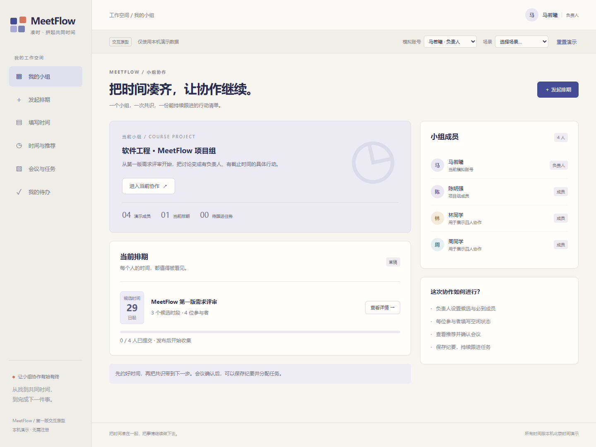
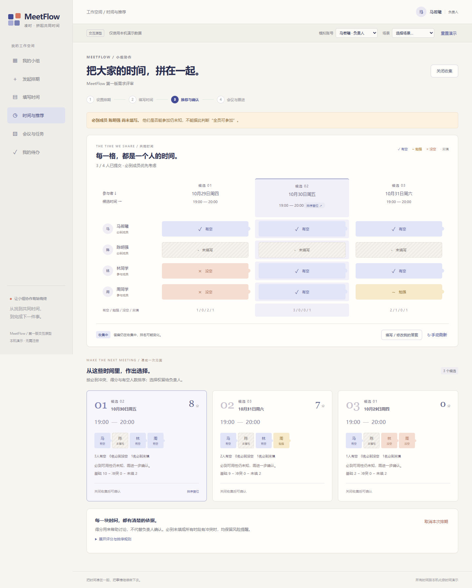

# MeetFlow T02 交互原型与验证记录

当前版本：P0.3｜日期：2026-10-26｜对应任务：T02。沿用需求V1.2、系统设计V1.0和文档整理基线B1，未调整第一版功能范围。

## 1. 本轮交付

已形成6个可点击页面：我的小组、发起排期、填写时间、时间与推荐、会议与任务、我的待办。主流程包含发布收集、四账号填写、负责人关闭与确认、纪要、任务创建和进度更新；另提供必到未填、全时段冲突及保存失败场景。

本轮由马若曦发起Agent协作形成原型及验证证据。任务计划中的陈明强仍负责原型协作与复核，实际工作量和贡献比例按后续完成情况记录。本记录没有将自动化检查写为组员或真实用户已试用。

原型使用本机浏览器演示数据；正式产品仍按Vue/FastAPI/SQLite实施。当前没有真实注册登录、建组入组、后端鉴权或事务保证；原型检查通过不等同于AC/NFR或T09～T36业务验收完成。

## 2. 访问与演示

从仓库根目录执行：

```powershell
python Src/scripts/preview_prototype.py
```

打开 [本机原型](http://127.0.0.1:8765/)。可用 `--port 8766` 更换端口；本机服务关闭后地址失效。完整体验顺序、数据重置和测试方法见[原型说明](../Src/prototype/README.md)。

该地址供本机体验；仓库中的原型源码与截图供他人下载查看。公开共享原型平台地址尚未建立，本轮没有发布公网应用。

## 3. 页面截图

截图来自2026-10-26的Chrome自动化演示。候选日期随运行日期生成，截图不是实际课程会议安排；演示参与者也不代表新增开发组员。

| 截图 | 体现的交互 |
| --- | --- |
| [01 我的小组](images/prototype/01-group.png) | 进入排期、演示成员和当前进度 |
| [02 发起排期](images/prototype/02-draft.png) | 主题、截止、候选、参与者与必到设置 |
| [03 填写时间与失败保留](images/prototype/03-vote.png) | 三态选择、全量提交和保存失败提示 |
| [04 必到成员未填写](images/prototype/04-required-unknown.png) | 未知提示、矩阵与可解释推荐 |
| [05 全部时段有冲突](images/prototype/05-all-conflict.png) | 不夸大推荐可行性，不自动确认 |
| [06 会议与任务](images/prototype/06-meeting.png) | 纯文本纪要、执行人、截止时间和任务列表 |
| [07 个人待办](images/prototype/07-personal-tasks.png) | 本人任务、完成过滤和重开 |
| [08 风险确认](images/prototype/08-confirm-risk.png) | 选择理由和明确风险确认 |
| [09 窄窗口](images/prototype/09-compact-window.png) | 640×520下的单列内容与图标导航，修复卡片覆盖侧栏 |





## 4. 本轮实际验证

| 层次 | 环境/方法 | 实际结果 |
| --- | --- | --- |
| 文档与仓库 | Python 3.11标准库检查 | 22项通过：引用、追踪、任务依赖、图文来源等 |
| 原型规则 | Node.js 22.20.0；`model.test.mjs` | 13项通过：文档算例、稳定排序、草稿校验、截止边界、全量提交、确认去重、权限分支、任务完成/重开等 |
| Chrome流程 | Chrome 156.0.8078.47；Playwright驱动真实浏览器 | 四模拟账号走通主流程；漏填、失败保留、未关闭不能确认、两项任务、成员只读、刷新保留、纯文本脚本不执行均通过 |
| Edge流程 | Edge 155.0.4283.62；同一浏览器脚本 | 同样流程及异常分支通过 |
| 场景与视口 | 两浏览器；1440×1080及1280×720 | 必到未填、全冲突、理由与勾选交互通过；最小桌面视口无整页横向溢出 |
| 图片复核 | 查看生成的入口、推荐及会议截图 | 布局、中文显示和主要状态可读；临时成功提示不遮挡交付截图 |

规则和浏览器检查分别保存在[规则测试](../Src/prototype/model.test.mjs)与[浏览器验证脚本](../Src/prototype/browser.check.mjs)。浏览器脚本使用临时端口和独立上下文，不污染日常演示数据；失败时以非零状态退出。

本轮没有测试真实网络接口、SQLite并发、用户密码、运行性能、5名真实用户易用性、手机或公网环境。浏览器中的权限分支用于讨论页面设计，安全性仍须后端验证。

### P0.2 窗口缩小修复（2026-10-26）

根据马若曦截图反馈，复现了缩小窗口后的整页横向溢出。原样式设置了1080px最小宽度，横向移动时，带定位的主卡片还可能覆盖缺少显式层级的固定侧栏。

本次为侧栏设置独立层级、为主内容隔离层叠上下文，并取消整页最小宽度。1050px及以下改为单列内容，720px及以下使用保留文字名称与悬停提示的图标导航；低窗口可滚动侧栏。布局检查新增1024、800及640×520视口，实际横向/纵向移动后检查侧栏命中目标与整页宽度，两浏览器均通过。此修复用于桌面窗口缩小，不作为手机适配或真实用户易用性验收结果。

## 5. 复核与下一步

### P0.3 时间拼图方向A（2026-10-26）

马若曦选择“时间拼图”方向。本轮先形成填写页与推荐页的可操作样稿，等待视觉与交互反馈；没有把方向选择记为组员已经验收完整界面。

- 共享风格：暖白背景、靛蓝操作色、珊瑚橙强调；四块时间构成品牌标记，侧栏改为轻底色。主题单独维护在`Src/prototype/puzzle.css`。
- 填写页：每个候选时段一张日期卡片，提供三个大点击区域；选择后更新卡片和已选数量，仍为全量提交；未保存的选择不计入小组已提交进度。
- 推荐页：参与者与候选时间组成拼图矩阵；答案保留文字与符号，未知采用斜纹留白；“排序首位”只表达排序，不表示满足全部必到成员。
- 推荐卡：沿用原分数与顺序，增加成员状态小拼块，保留冲突、未知、分数组成与人工确认。会议页和任务流程继续沿用原规则。

新版已在Chrome与Edge验证：点击与方向键选择、混合三态答案在失败后保留、12个已填格和3个必到未填格与演示输入一致；15个有效候选在表格内部滚动；填写页、推荐页和小组页在1024、800、640×520下无整页横向溢出或侧栏遮挡。9张截图已更新为本版，其中03展示三态选择与失败保留、04展示未知风险、09展示紧凑窗口。上述结果仍只针对原型。

组员复核时重点确认：候选时间输入是否清楚，未知/冲突说明是否便于理解，确认理由是否容易填写，纪要与任务是否能承接会后跟进。反馈按真实意见记录，不预填“满意”或“已通过人工验收”。

接下来按T03核对用例、状态、ER和时序图与原型的对应关系，按T04确定表单与状态展示规范，再进入工程脚手架和业务实现。本原型可随讨论修订，变更记录在[13](13-版本与变更记录.md)。
