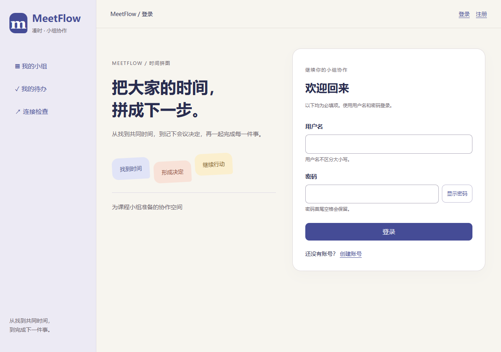
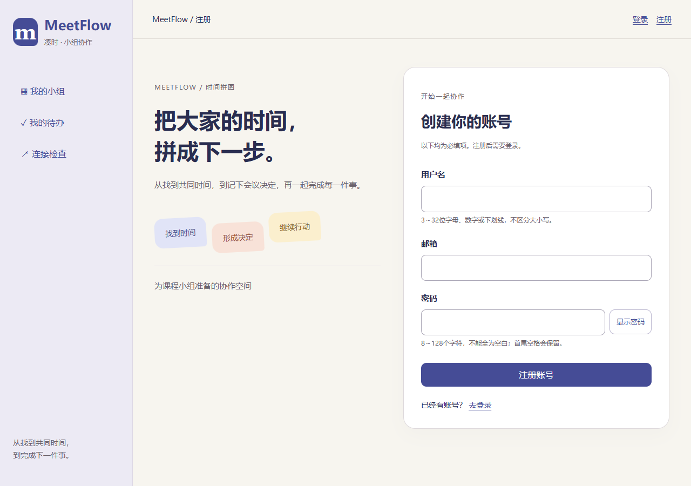
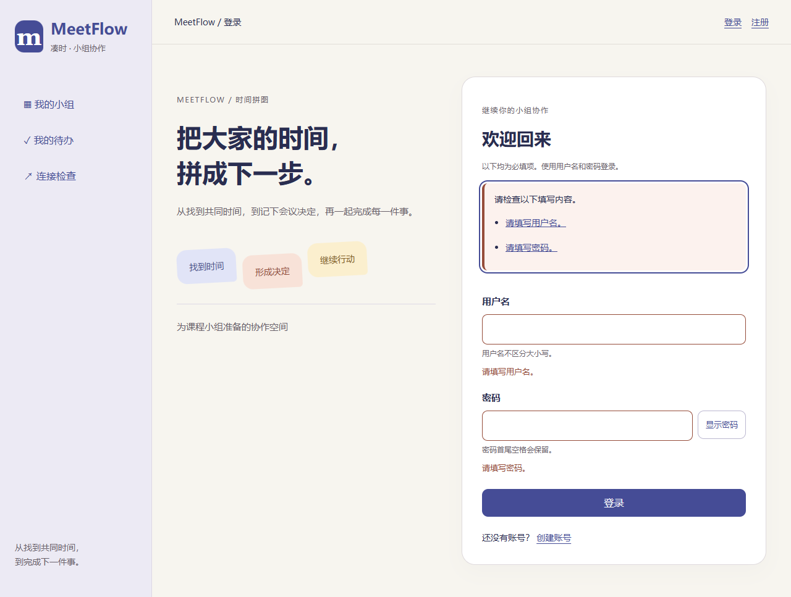
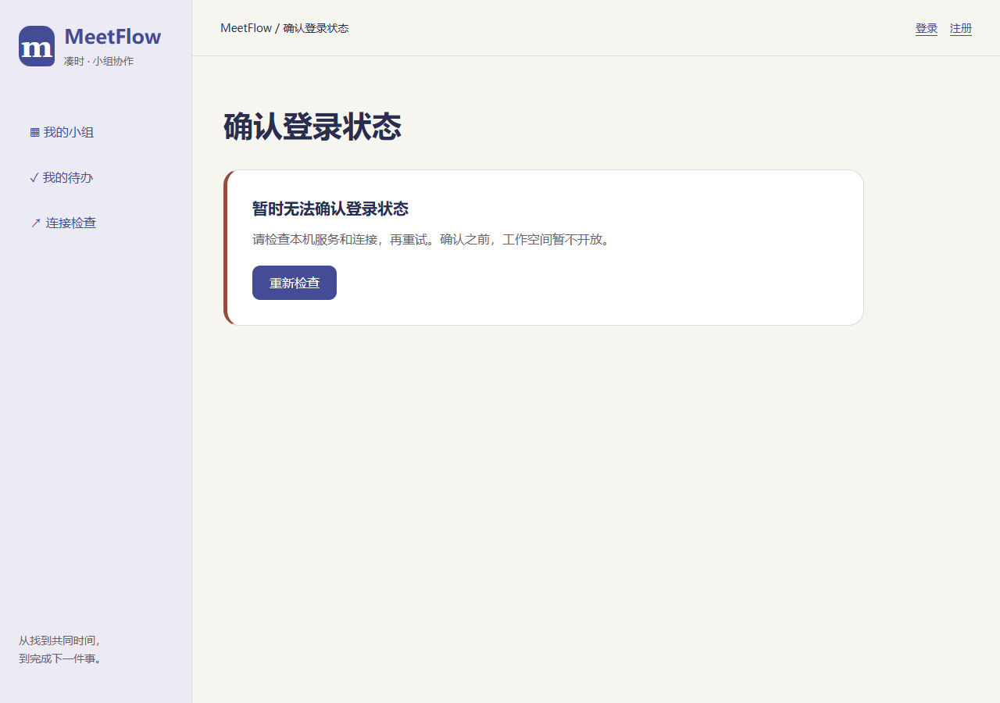

# T10 注册登录页面与守卫

日期：2026-10-26。对应MF-01，沿用本机桌面第一版和“时间拼图”界面。正式工程使用真实账号；原型仍单独保留。

## 本轮行为

- 注册成功后转登录页，带入用户名和成功提示，不自动登录，不保留密码。
- 表单提供字段校验、错误汇总与焦点定位、显示密码、提交中禁用、失败保留输入和离开确认。密码首尾空格保留，长度按Unicode字符计算。
- 业务路径进入前核对服务端会话。未登录跳登录，登录后返回安全的原路径；只允许站内已知受保护路径，不携带原查询和片段。
- 刷新重新读取会话，退出撤销后再离开。会话过期清空身份；连接失败进入可重试的状态核对页，确认前不渲染受保护页面。
- 提交结果不确定时不自动重发。登录、退出读取当前会话核对；注册引导登录核对。编辑输入不会隐藏核对按钮。
- 身份变化会重新创建受保护页面，旧请求的401不会清掉新身份。凭据和表单不写浏览器存储或URL；注册后的用户名提示只在内存中消费一次。

## 验证

前端79项单元测试及TypeScript/Vite构建通过。Chrome、Edge正式构建与Chrome开发代理验证注册、错误登录、刷新、退出、过期、安全返回、断网恢复、损坏响应后的核对、重复提交防护及离开确认；登录表单1280/800/400宽度无横向溢出。浏览器脚本显式迁移临时库，不写开发数据。

复现：在 `Src/frontend` 执行 `npm test`、`npm run build`、`npm run check:auth-ui`；浏览器环境配置见[前端说明](../Src/frontend/README.md)。

| 登录 | 注册 | 校验 | 连接恢复 |
| --- | --- | --- | --- |
|  |  |  |  |

小组、排期、会议和任务页仍为受保护的阶段占位页，后续逐步接入。此记录不代表完整业务或产品验收完成。
