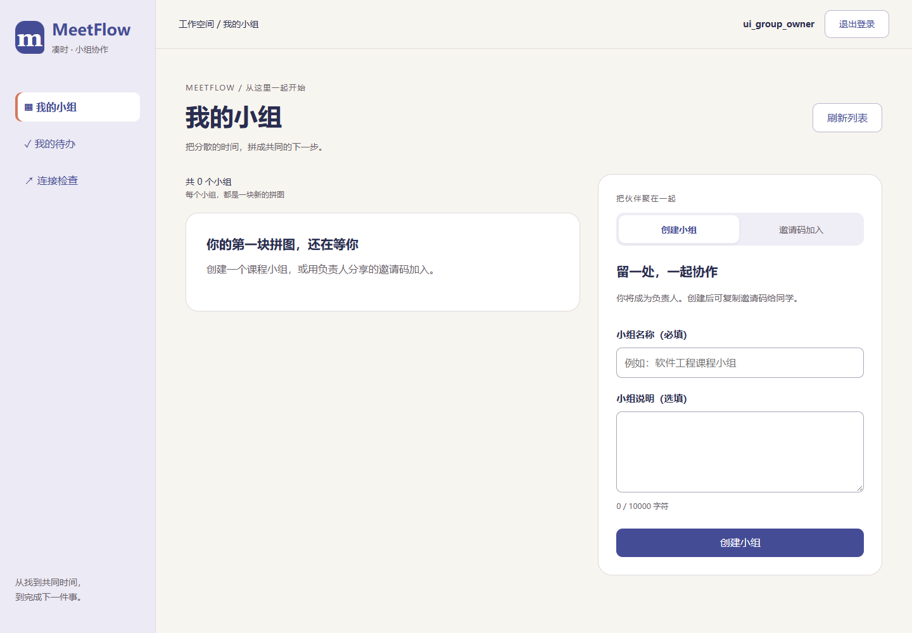
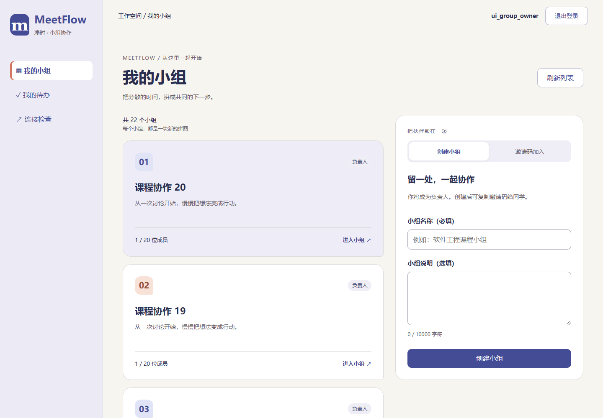
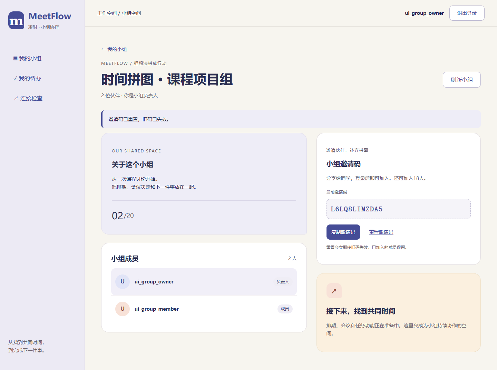
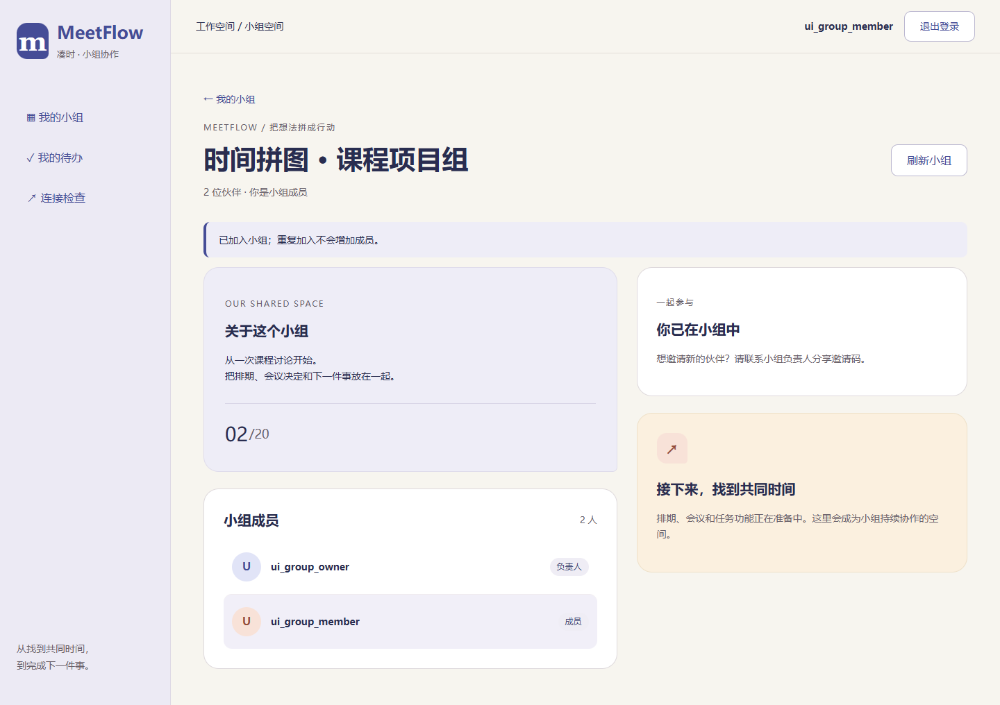

# T13 小组页面与交互验证

日期：2026-10-26。对应MF-02、UI-02和AC-02，接入[T12真实接口](23-小组成员与邀请码接口.md)，沿用暖白、靛蓝和珊瑚橙的“时间拼图”界面。无后端接口、迁移或依赖变更。

## 已完成

- `/groups`：本人小组卡片、负责人/成员标记、人数、分页、手动刷新，以及创建/邀请码加入表单。只有成功读取后才显示空列表，读取失败保留上次内容并禁用提交。
- `/groups/{id}`：组说明、成员与本人标记。负责人可复制、重置邀请码；普通成员没有管理入口。组外访问显示统一404，不显示组名、成员或邀请码。
- 创建后进入详情，加入及重复加入后进入原组；成功提示只消费一次，刷新重新读服务端，不重复显示保存成功。
- 复制失败时选中代码并提示Ctrl+C；重置先确认旧码失效的影响。重置结果不确定或读取失败时隐藏过时代码，重新读取成功才允许复制和再次重置。
- 字段校验、服务端422定位、错误汇总焦点、失败保留、单次提交禁用、离开/刷新确认均已接入。已提示的字段错误在输入修正时清除，避免失焦收起提示导致按钮在点击过程中移位；登录表单同步修正。
- 提交不确定时不自动重发。创建先核对列表，同名不能证明创建成功，仍要重试需明确确认可能重复；入组核对后可手动再提交，服务端保证成员去重。
- 会话过期仍能跳转登录，清空旧账号草稿并说明原因；新账号不继承旧输入。切换详情取消旧读取，晚到响应不覆盖新小组；说明按纯文本呈现。

## 验证

2026-10-27界面微调：人数简化为“01/20”；负责人固定置顶，其余成员保持读取顺序。移除“这是你”，本人整行使用浅紫底色，并保留无障碍名称。浏览器回归使用倒序成员响应确认负责人仍置顶，同时检查本人高亮与简约人数。

同日按反馈将人数缩小为28px，容量“/20”为18px，保持原位置与简约样式，浏览器检查实际字号。

前端116项（新增37项）及TypeScript/Vite构建通过，后端225项、仓库32项回归通过。Chrome、Edge正式构建和Chrome开发代理通过真实浏览器交互：创建/入组、422/404/409、重复点击、成员权限、重置确认/旧码、复制与失败后手动复制、三类不确定写结果、分页/断网、旧读取取消、未保存离开、过期后换账号、纯文本及400～1440宽度。

浏览器测试显式迁移临时数据库，模拟数据与故障仅存在于测试上下文，不写开发数据库。复制检查使用受控剪贴板替身，不覆盖本机剪贴板。复现：在 `Src/frontend` 执行 `npm test`、`npm run build`、`npm run check:groups-ui`；开发代理执行 `node browser.check.mjs --groups-ui --auth-ui`。浏览器环境见[前端说明](../Src/frontend/README.md)。

| 空列表/创建 | 列表 | 负责人详情 | 成员详情 |
| --- | --- | --- | --- |
|  |  |  |  |

排期、会议、任务仍未接入，不提供可误认为已完成的操作；下一项T14实现排期、参与者与时段模型，随后T15接口、T16负责人编辑页。本记录不替代完整产品验收或真实用户试用。
