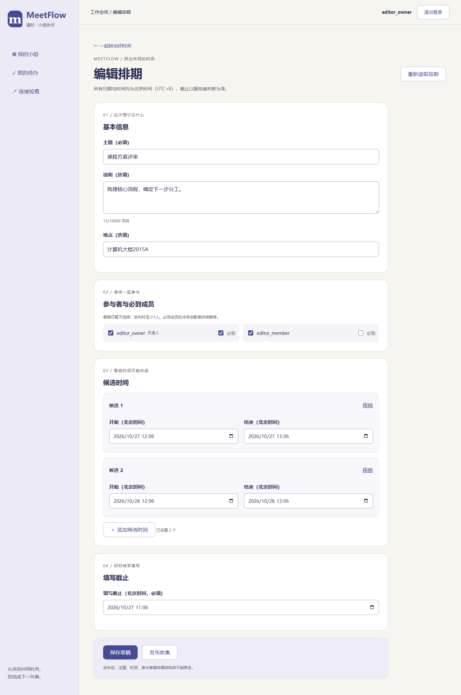
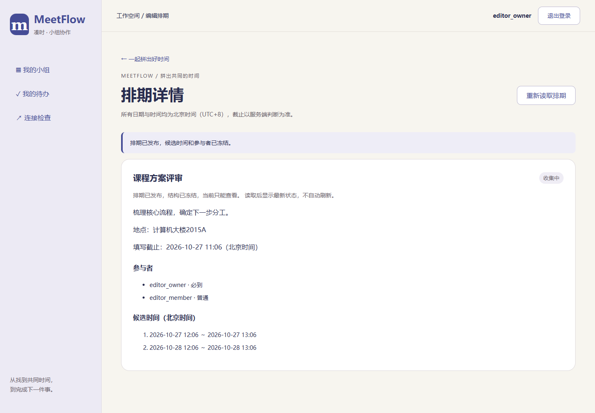
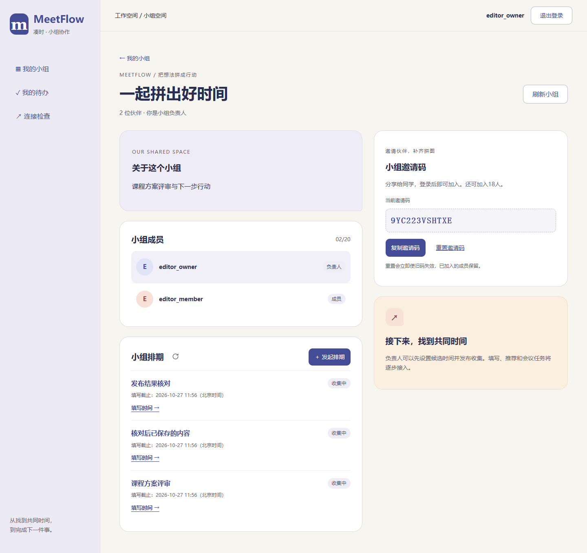

# T16 负责人排期编辑与发布

日期：2026-10-27。对应MF-03、MF-04和UI-03，接入T15真实接口，沿用“时间拼图”界面；无后端、数据库迁移或依赖变更。

## 已完成

- 小组详情增加排期列表、有效状态、分页和手动刷新；负责人可“发起排期”，成员可进入查看。空列表只在读取成功后展示，失败保留上次列表。
- `/groups/{groupId}/polls/new`：主题、说明、地点、参与者、必到选择、候选时间增删和填写截止。草稿可空参与者/候选，但须满足其他字段与时间格式校验。
- `/polls/{pollId}/edit`：重新读取已保存草稿，整体保存；只有已保存且本页没有未保存修改时才能单独确认发布。发布前检查1～15候选、至少1参与者、未来截止且早于每个候选，服务端仍是最终判断依据。
- 日期标注北京时间，按固定UTC+8转换，不随浏览器所在时区变化。字段校验、服务端422定位、错误汇总焦点、失败保留、提交中禁用、离开/刷新确认均已接入。
- 发布后显示服务端只读详情，普通成员始终只读；成员直接访问发起页无编辑表单，组外404不展示内容。当前不提供关闭/取消的页面操作或投票表单。
- 创建结果不确定先读取小组排期分页核对，同名不代表成功；再次创建需确认可能重复。保存结果不确定时比较规范化服务端内容，一致则确认已保存，不一致保留本页输入，需载入服务端版本或明确确认再保存。
- 发布响应丢失先读取最新状态，不自动重发发布。草稿被其他操作发布后，服务端只读内容与本页未保存输入分开显示，禁止继续编辑。会话过期清空旧账号输入，新账号不继承。

## 验证

前端152项通过（新增36项），TypeScript/Vite构建、后端358项及32项仓库检查通过。Chrome、Edge正式构建和Chrome开发代理验证：入口与重新进入、北京时间跨日/毫秒转换、必到与候选增删、重复候选、保存一次、刷新/离开确认、发布确认取消、422定位、发布只读、成员/组外权限、创建/保存/发布响应损坏、核对读取失败恢复、服务端内容不同、并发状态冻结、过期后换账号、400～1440宽度。

浏览器上下文使用America/Los_Angeles时区检查北京时间转换；临时账号、排期及故障只在独立迁移的测试库中，不写开发数据。不使用浏览器存储或URL保存真实表单。

复现：在 `Src/frontend` 执行 `npm test`、`npm run build`、`npm run check:poll-editor`；开发代理用 `node browser.check.mjs --poll-editor --groups-ui --auth-ui`。浏览器环境见[前端说明](../Src/frontend/README.md)。

| 草稿编辑 | 发布后只读 | 小组排期入口 |
| --- | --- | --- |
|  |  |  |

下一项T17实现本人全量投票接口，T18再接空闲状态填写页；本轮发布状态可验证，不表示成员投票、推荐、会议或完整产品验收已完成。

## 时间输入调整（2026-10-27）

移除候选时间和填写截止下方的常驻规则备注。时间输入停顿450毫秒或离开输入框后，在对应字段下方以红字提示无效日期、结束不晚于开始、重复时段、过去的截止及截止不早于候选开始等问题；未操作的空字段不提前报错，保存草稿仍允许暂缺候选和参与者，发布时检查完整规则。

输入框、重新载入的草稿和只读详情统一显示到分钟。旧数据中的秒和毫秒不会因查看而改写，主动保存编辑后的时间按分钟提交；服务端时间格式与最终发布校验保持不变。

本次验证：155项前端测试、TypeScript/Vite构建、32项仓库检查，以及Chrome、Edge正式构建的排期流程检查通过。浏览器覆盖不提交即出现的红字提示、修改依赖时间后重新校验、分钟精度、保存重载及发布只读；后端未改动。
