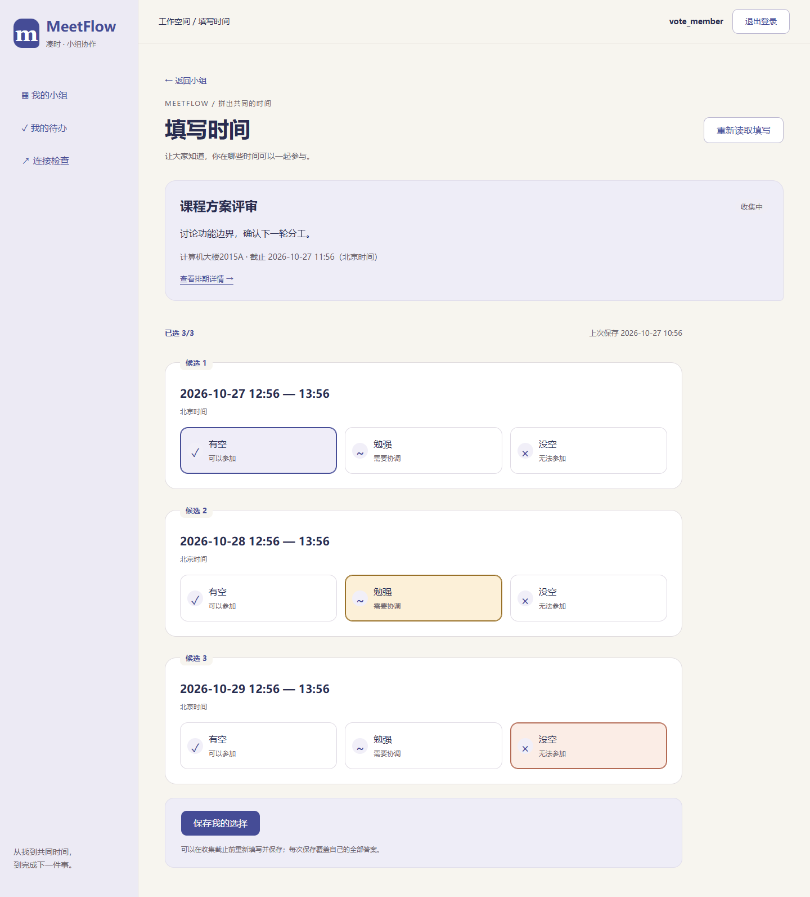
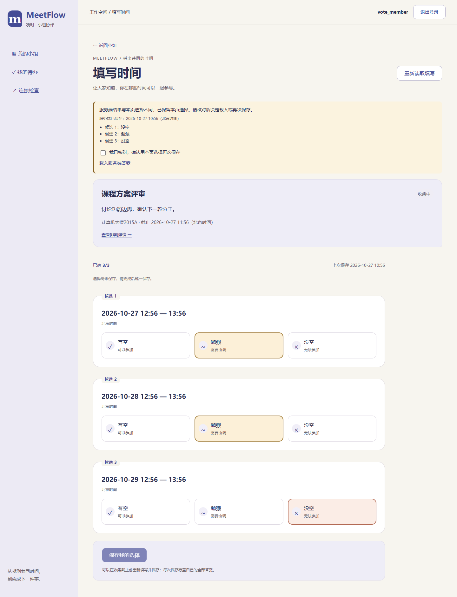
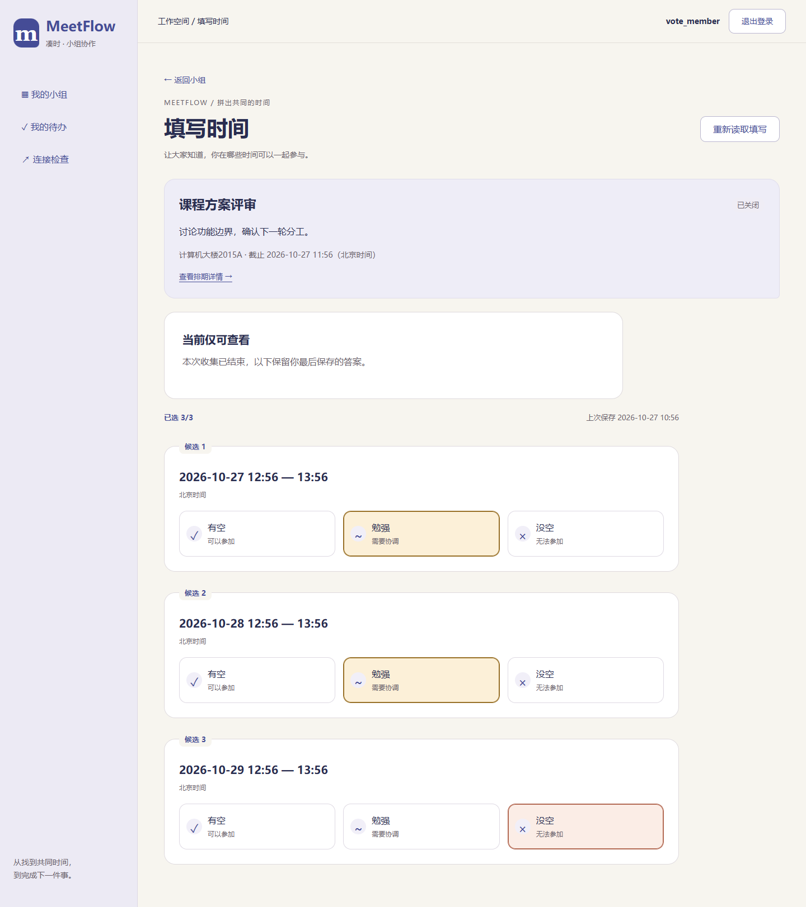

# T18 空闲状态填写页面

日期：2026-10-27。对应MF-06、UI-04、AC-04/05，接入T17本人答案接口。沿用“时间拼图”样式，无后端、数据库或依赖变更。

## 已完成

- `/polls/{pollId}/vote`：每个候选时间一张卡片，原生单选提供“有空／勉强／没空”，颜色、符号和文字共同表达状态，支持键盘切换。时间按北京时间显示到分钟，跨日时保留结束日期。
- 小组排期列表与只读详情为参与者提供填写入口；结束后入口改为查看本人填写。非参与者无填写入口，直达页面只有说明；组外404不展示排期内容。
- 进入页面读取服务端原答案，未提交保持未知，不预选“没空”；显示本页已选数量及最后保存时间。本页选择不冒充小组提交进度，矩阵与提交进度留T19/T20。
- 全部时段选完后一次保存；漏填时显示逐项红字及可定位的错误汇总，保存中禁用输入及重复提交。成功后才显示保存成功，刷新后读取服务端已保存数据。
- 422保留选择；断连、5xx或损坏响应先核对GET结果，不自动重发PUT。若服务端答案与本次提交一致，确认已保存；不一致时分别显示两份结果，用户可载入服务端答案或明确确认后重新保存。核对读取失败可重试，不丢失本页输入。
- 草稿不可填，关闭/取消/确认后只读；截止以服务端为准。填写途中被关闭而保存遭拒时，保留本页选择，读取最新状态和已保存答案供核对，禁止继续提交。
- 未保存离开或重新载入须确认；会话失效跳转不被离开确认拦截，新账号不继承旧选择。不把答案写入浏览器存储或URL。
- 按用户要求去掉“刷新排期”文字按钮，在“小组排期”标题右侧放透明背景、单圆弧箭头图标，保留悬停提示与无障碍名称，读取中禁用。

## 验证

前端172项测试通过（新增17项），TypeScript/Vite构建及32项仓库检查通过。Chrome、Edge正式构建验证上述填写流程、键盘、读取/写入故障、结果核对、权限、关闭竞争、过期后换账号及400～1440宽度；Chrome同时回归T16编辑发布流程，开发代理下填写页及T13小组页面联动验证通过。测试使用独立临时库，不改动开发账号和答案。

复现：在`Src/frontend`执行`npm test`、`npm run build`、`npm run check:votes-ui`。浏览器运行环境见[前端说明](../Src/frontend/README.md)。

| 已保存的三态选择 | 提交结果核对 | 收集结束后回看 |
| --- | --- | --- |
|  |  |  |

下一项T19实现矩阵与提交进度接口；当前尚未实现真实矩阵、推荐、会议和任务流程，不表示完整产品验收已完成。
