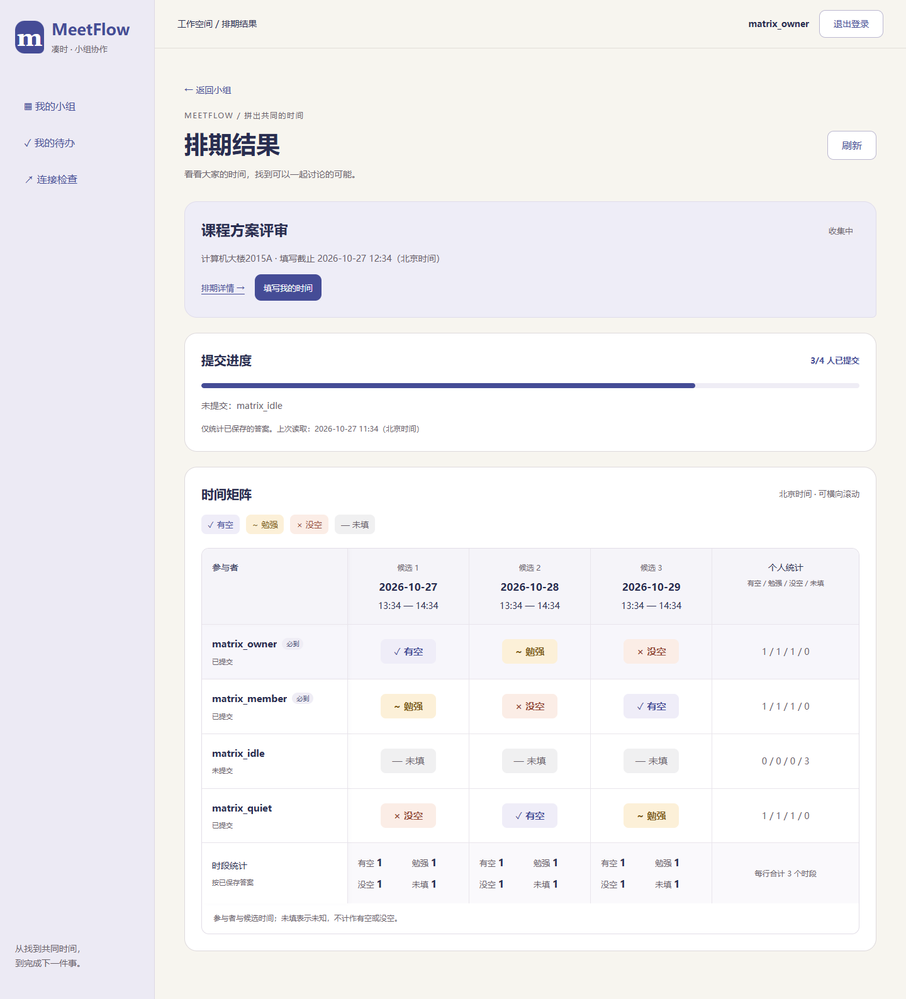
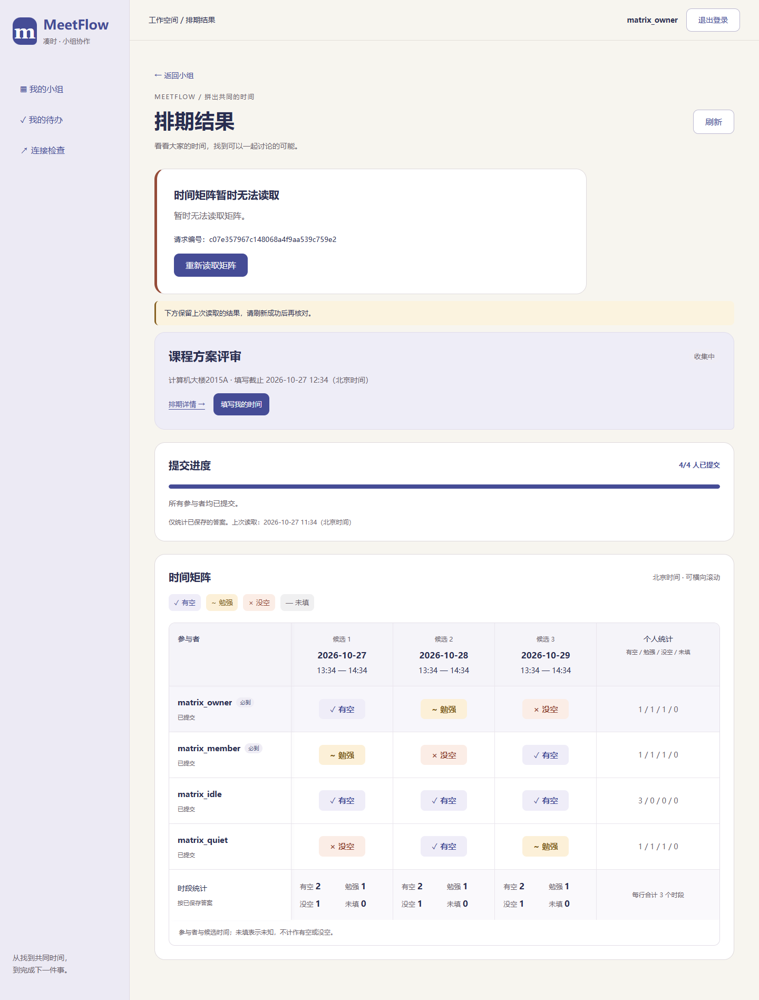
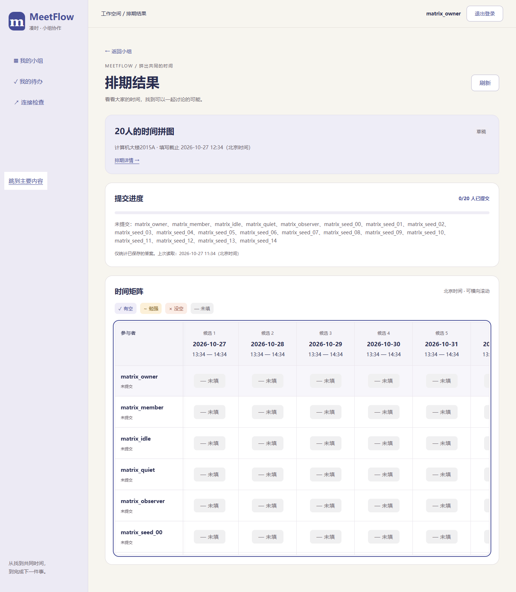

# T20 矩阵与提交进度页面

日期：2026-10-27。对应MF-07、UI-05、AC-06及TV-06，接入T19矩阵接口。无后端、数据库或依赖变更；推荐与会议确认按后续任务实现。

## 已完成

- `/polls/{pollId}/results`显示提交人数、进度条、未提交名单、成员×时段矩阵、个人四类计数及各时段四类计数。只统计服务端已保存答案，本页未保存选择不进入进度；未填明确显示为未知，不当作有空或没空。
- 有空、勉强、没空、未填分别配文字、符号和颜色。当前账号所在行用浅色背景；必到标签按用户反馈放在姓名右侧同一行。日期、状态和统计数字增强字号与字重，次要说明保持小字。
- 宽矩阵在自身区域横向滚动，姓名列固定左侧，表头固定顶部；滚动区可键盘聚焦。20×15数据不撑宽页面，长姓名保留完整文本与悬停标题。
- 小组排期增加“查看矩阵”入口，排期详情、填写页也可进入。组内非参与者可查看；OPEN参与者可跳转填写本人时间；结束后仍可回看，组外不展示排期资料。
- 手动刷新、读取中禁用及无重复请求；刷新失败保留上次结果并明确标注。初始读取失败不显示假空矩阵；403/404清除旧结果；会话过期回登录，新账号不继承数据。不自动轮询，不保存答案到浏览器存储。
- 前端核对单元格完整笛卡尔积、归属、唯一性、四类计数及提交进度；缺格、重复、跨排期或统计不一致均作为读取失败，不展示伪造的最新统计。空草稿显示零进度和空提示，不显示“全员已提交”。

## 验证

前端203项测试通过（新增31项），TypeScript/Vite构建及32项仓库检查通过。Chrome、Edge正式构建检查四种状态、必到标签同行、重点字号、当前行、逐人逐时段统计、未保存选择隔离、手动刷新、503及损坏响应保留旧数据、404清空、组内非参与者/组外权限、空草稿、20×15在400～1440宽度的键盘滚动和固定姓名、关闭后查看及过期换账号。Chrome同时回归T16编辑发布与T18填写流程。

全部账号、答案及故障仅在独立临时测试库中，不改动开发数据。截图已人工核对。

复现：在`Src/frontend`执行`npm test`、`npm run build`、`npm run check:matrix-ui`。环境见[前端说明](../Src/frontend/README.md)。

| 四人三时段 | 刷新失败保留结果 | 20人×15时段 |
| --- | --- | --- |
|  |  |  |

下一项T21实现评分、稳定排序与解释；当前页面尚未显示推荐排名或会议确认，不代表完整产品验收已完成。
