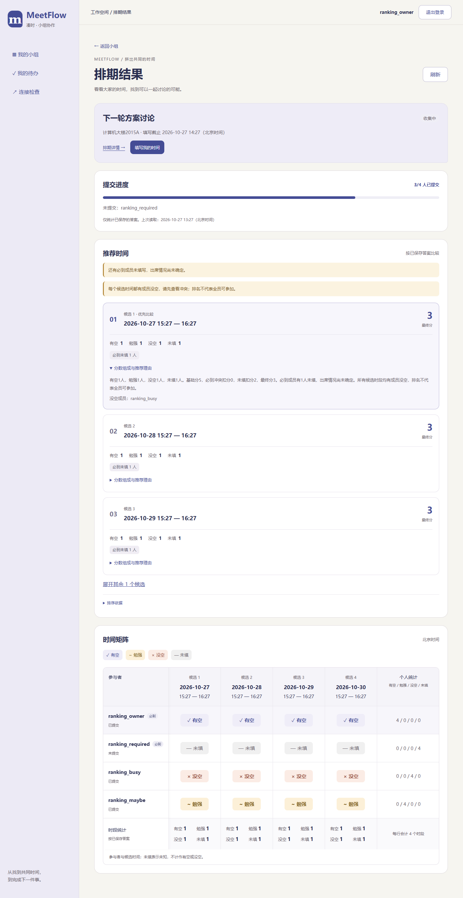
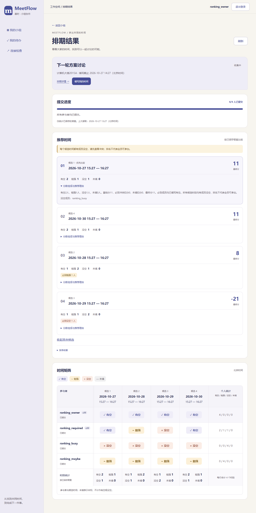
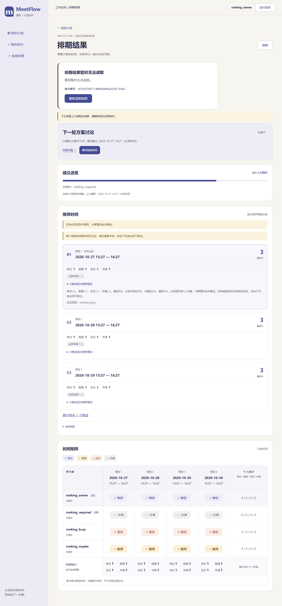

# T23 推荐结果与冲突提示页面

日期：2026-10-27。对应MF-08、UI-05及AC-07。接入T21真实推荐接口，放在排期结果页的提交进度下方、矩阵上方；排版待马若曦确认。

## 页面行为

- 默认显示前三个候选，突出排名、日期时间和最终分；其余候选可展开。第一名标为“优先比较”，不冒充已确认会议或无冲突时段。
- 每个候选显示有空、勉强、没空、未填人数；必到没空、未填、勉强分别提示。所有候选都有成员没空时，统一警告排名不代表全员可参加。
- “分数组成与推荐理由”可展开查看服务端解释、基础分、扣分和没空成员；排序依据可展开了解。说明使用纯文本，不执行服务端文本中的HTML。
- 组成员均可看，未列入参与者的组员没有代填入口。OPEN/CLOSED/CONFIRMED展示推荐；草稿提示发布后查看，取消后不生成推荐。不提供尚未实现的会议确认操作。
- 推荐和矩阵的候选、四态人数、必到风险和冲突成员必须一致；请求之间答案变化造成不一致时视为读取失败，提示刷新，不混用两份结果。失败保留上次完整结果并标记，403/404及换账号清除旧数据，不自动重试或轮询。

## 验证

前端220项测试通过（新增17项），TypeScript/Vite构建及32项仓库检查通过。Chrome、Edge验证服务端排名/得分、必到未填/勉强/没空、全时段冲突、展开收起、分数组成、503/损坏响应保留旧快照、HTML文本不执行、成员查看、关闭及取消状态、400～1440宽度，并回归T20矩阵。

后端规则已完成T21的449项完整回归与T22的16项新增边界测试；本项没有新迁移或依赖。所有浏览器样本仅在独立临时库中，本地服务已加载推荐接口，未填入开发测试答案。

复现：在`Src/frontend`执行`npm test`、`npm run build`、`npm run check:recommendations-ui`；浏览器环境见[前端说明](../Src/frontend/README.md)。

| 必到未填时 | 必到风险与排名 | 推荐读取失败 |
| --- | --- | --- |
|  |  |  |

按用户本轮授权，后端/测试项连续推进到T22；T23完成后暂停，等待推荐区排版反馈，再继续T24会议确认事务。
