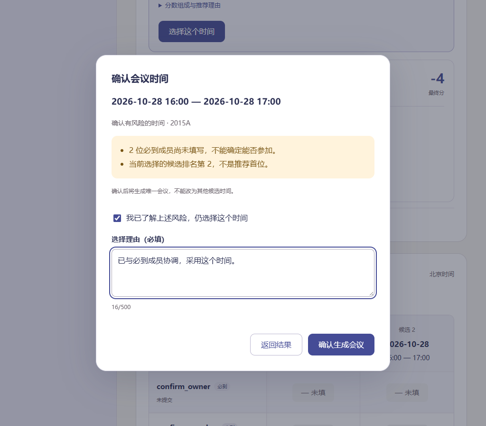
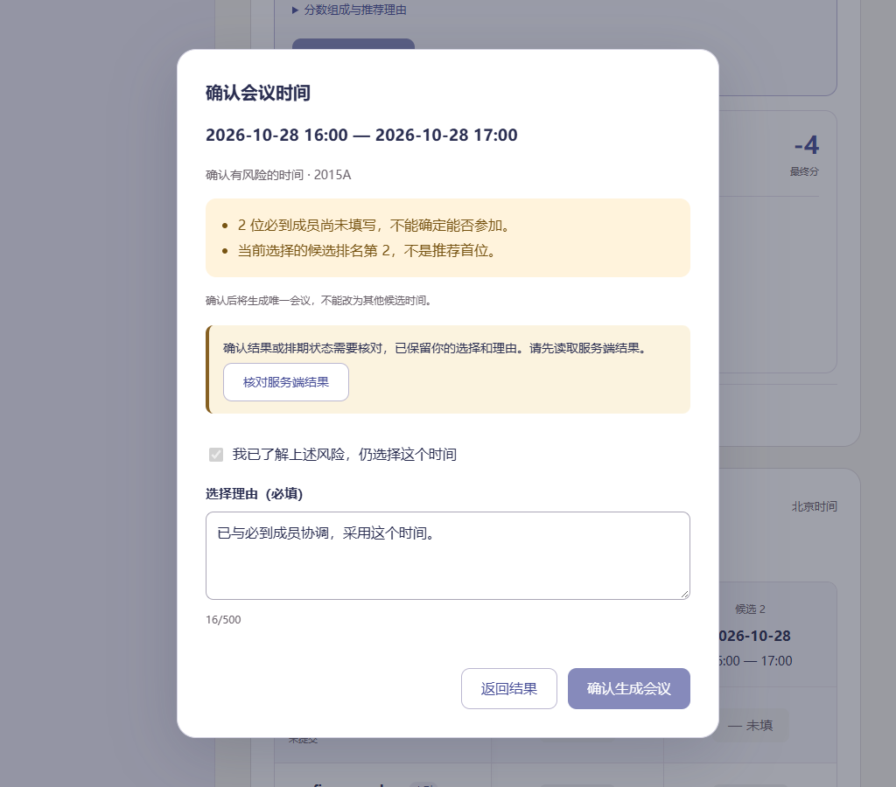
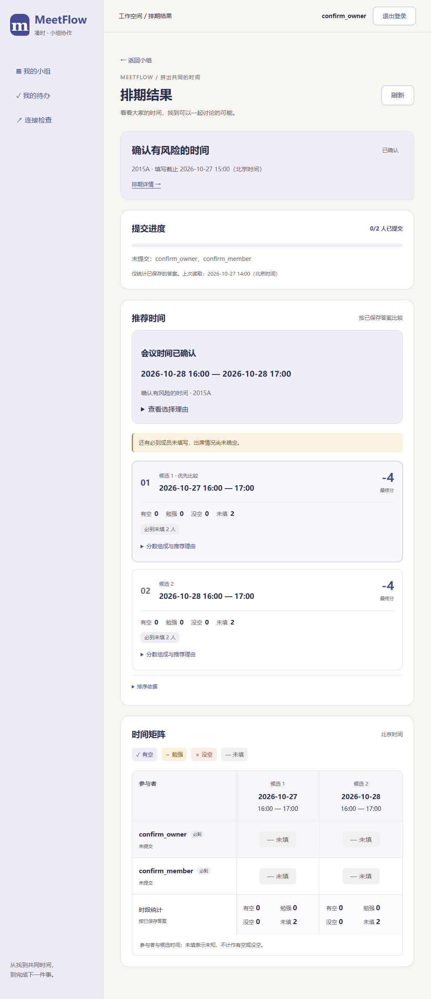

# T25 会议确认交互与验证

日期：2026-10-27。对应MF-09、UI-05。结果页接入真实会议确认接口；排版待马若曦确认。

负责人可先“结束收集”，再在推荐卡片选择时间。弹窗突出候选时间，列出必到没空、未填、勉强及非首选提醒。必到没空/未填或非首选时须勾选风险并写1～500字理由；首位且没有这些风险时理由选填。必到勉强仍提示协调。取消或Esc可以退出，提交期间禁止重复操作。

保存后展示实际会议快照。成员能查看但没有确认按钮；已确认、取消、未关闭状态不能改选。读取失败保留上次结果并禁用确认，403/404或身份变化清除旧内容。网络中断或状态冲突时保留输入，先“核对服务端结果”，读取成功后才能继续；不自动重发POST。确认产生的唯一会议不能换成其他候选。

同轮按反馈移除矩阵个人统计及每行合计，保留逐格状态、时段统计和提交进度。完整会议详情、议程、纪要及任务在后续任务实现。

验证：前端240项测试、正式构建、32项仓库检查通过；后端516项通过。Chrome和Edge验证结束收集/取消、角色隔离、风险和理由校验、400～1024宽度弹窗、Esc退出、安全首选、响应丢失后只读找回及刷新回看。Chrome回归矩阵及推荐页。测试使用独立临时库；开发库只做备份升级，无测试会议注入。

复现：在`Src/frontend`执行`npm test`、`npm run build`和`npm run check:confirmation-ui`，浏览器环境同前端README。截图为临时测试样本，不是实际项目数据。

| 风险确认 | 响应丢失后核对 | 已确认结果 |
| --- | --- | --- |
|  |  |  |

本轮停在确认弹窗排版验收，确认后继续T26议程与纪要接口。
