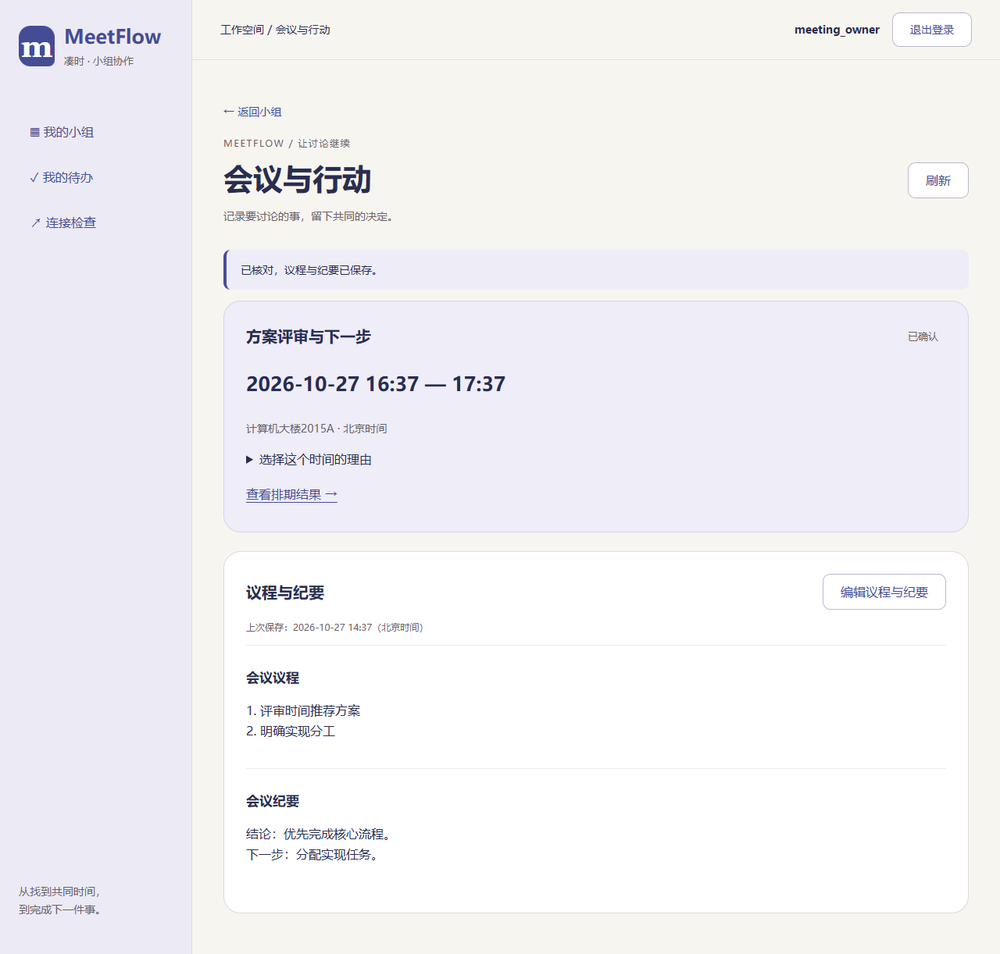
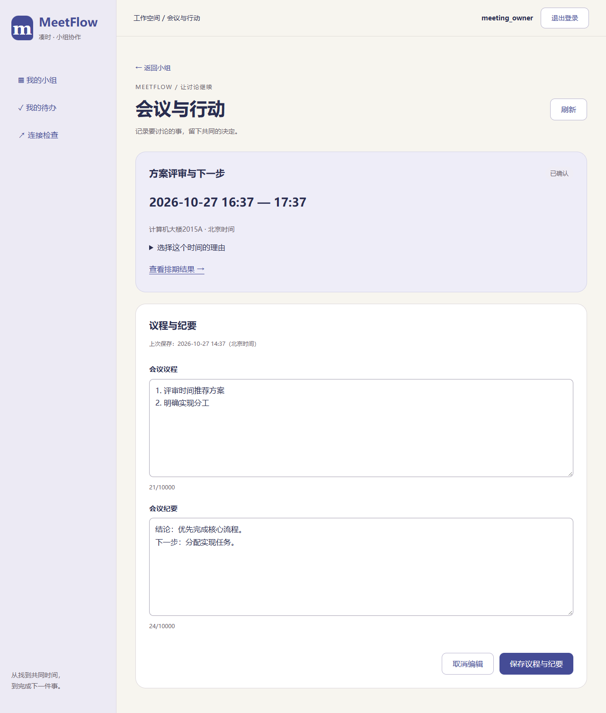
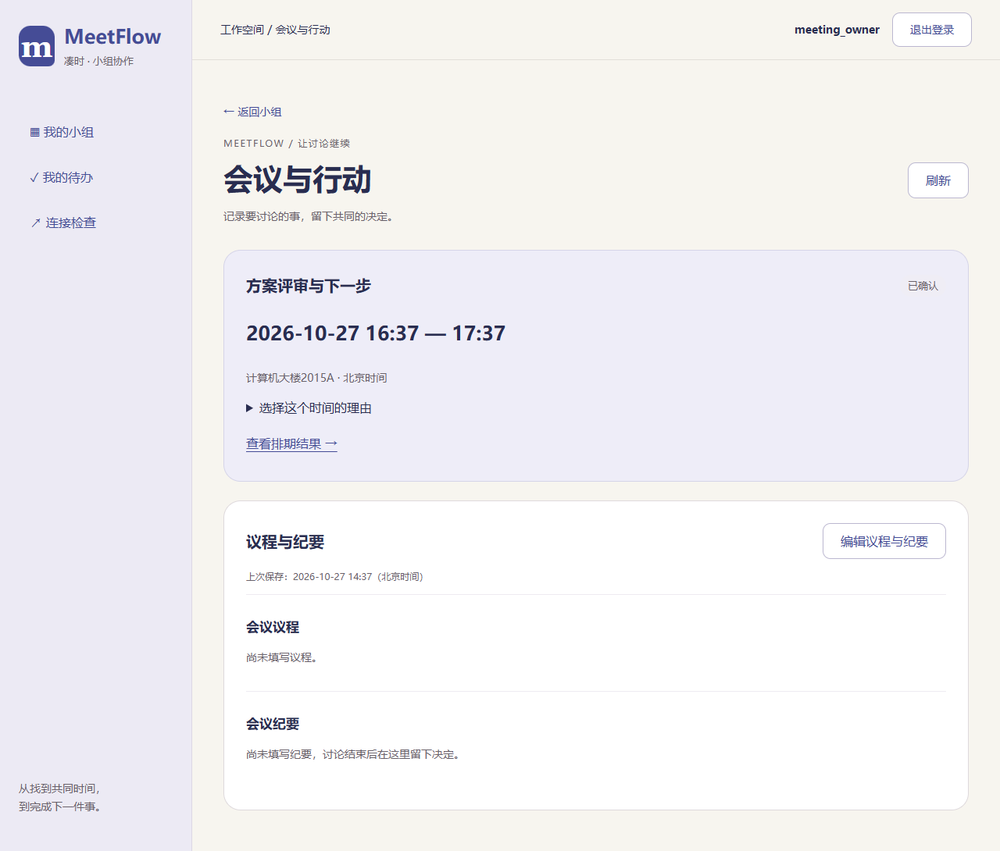

# T27 会议详情与纪要页面

日期：2026-10-27。对应MF-10、UI-06，页面排版待马若曦确认。

已确认排期的结果卡片新增“查看会议”，进入真实`/meetings/{m}`详情页。顶部显示冻结的标题、日期时间、地点及选择理由，支持返回小组和查看原排期结果。

议程与纪要集中在一张内容卡片：默认查看，负责人点击编辑后修改两项并保存；组员只读。空内容有简短提示，每项最多10000个Unicode字符，保留换行、可清空。内容仅按纯文本显示。取消、刷新或离开存在未保存修改时需确认；提交期间禁止重复保存。

保存成功显示反馈，重新进入仍读到已保存内容。响应丢失或结果不一致时保留输入，先读取服务端核对：与输入一致则确认保存；不一致则展示已保存内容，用户可选择采用它或保留输入继续编辑，不自动重发。读取失败保留上次结果并禁用编辑，身份失效或无权限时移除旧内容。

本轮同时完成结果页两处反馈：排期详情使用与“填写我的时间”一致的按钮样式；删除“按已保存答案比较”。T28任务接口及T29任务界面尚未实现。

验证：后端全量535项、前端253项、正式构建及32项仓库检查通过。Chrome、Edge验证真实入口、空值提示、编辑/只读、保存/清空/重新进入、超长及纯文本、刷新取消、503保留旧内容、保存前/后断网核对、400～1440宽度和身份隔离，并回归确认流程。

浏览器测试只用独立临时数据库。本机服务已重启加载API-09，无新数据库迁移，不注入测试会议或纪要。

复现：在`Src/frontend`执行`npm test`、`npm run build`、`npm run check:meeting-ui`；浏览器环境同前端README。

| 查看内容 | 编辑内容 | 尚无议程与纪要 |
| --- | --- | --- |
|  |  |  |

下一步先确认会议页排版，再继续T28。
