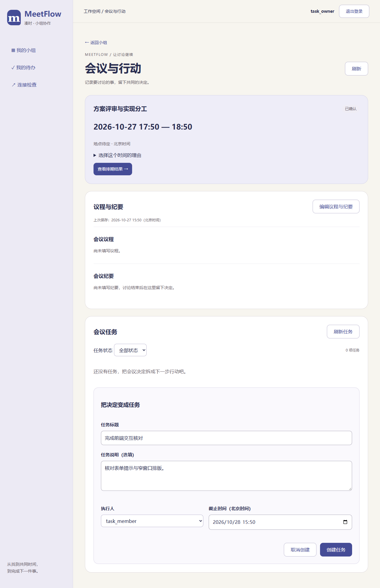
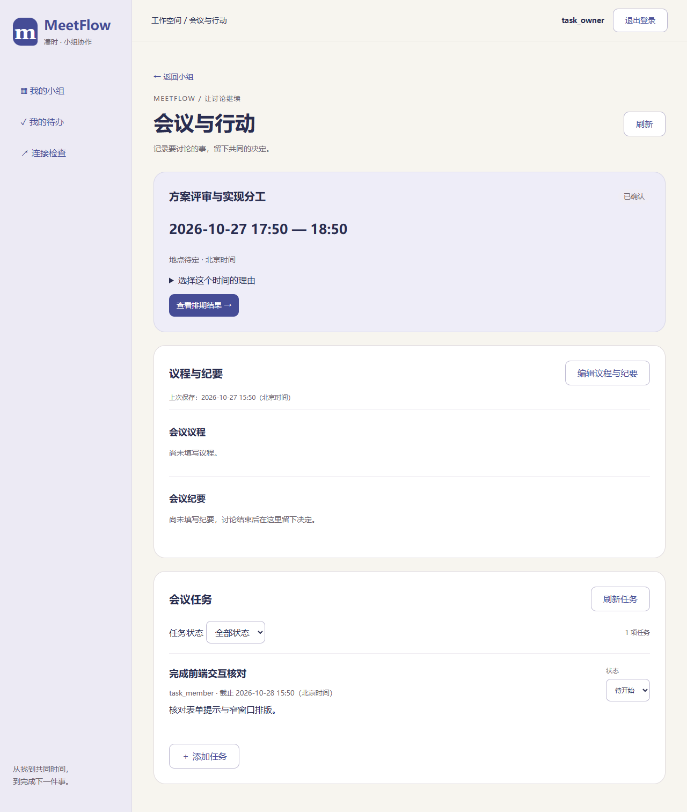
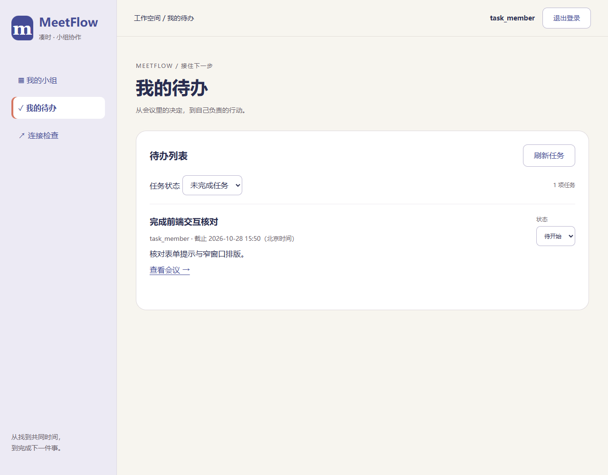

# T29 任务列表与个人待办页面

日期：2026-10-27。对应MF-11、MF-12、UI-06/07，页面排版已获确认；后续反馈删除创建成功提示，创建结果直接显示在列表。

会议详情下方新增会议任务。负责人可以添加任务，填写标题、可选说明、执行人和精确到分钟的北京时间截止；无效输入在字段下提示。保存前保留输入，提交期间禁止重复操作。同一次创建保留原UUID；响应丢失后只在用户明确操作时重试原请求，服务端复用原任务。冲突返回列表核对，不声称已创建。

同一任务在会议、小组与“我的待办”中展示。列表突出标题、执行人、截止和状态，说明按纯文本显示；任务来源可进入会议。小组默认全部状态，个人默认未完成，可筛选待开始、进行中或已完成，每页20条。

负责人和执行人可切换三态；其他组员只查看。完成后从默认个人待办移除，筛选已完成后可以重开。提交成功重新读取列表；失败保留原显示并禁用状态修改，先核对服务端结果，不自动重复写入。各处通过刷新或重新进入读取同一份数据，无后台轮询。

验证：后端572项、前端273项、正式构建及32项仓库检查通过。Chrome、Edge验证任务创建校验、响应丢失后相同UUID重试仅一条记录、负责人/执行人/普通成员权限、三处结果一致、完成筛选及重开、状态响应丢失后只读核对、503保留旧状态、分页和400～1440窗口；Chrome回归小组及会议页面。

本机库已备份升级0005并重启，未导入浏览器测试任务。测试使用独立临时数据库；截图仅为测试样本。

复现：在`Src/frontend`运行`npm test`、`npm run build`、`npm run check:tasks-ui`，浏览器环境同前端README。

| 创建任务 | 会议任务 | 个人待办 |
| --- | --- | --- |
|  |  |  |

后续T30～T35自动化验证与交付材料见41号报告，真实试用状态见43号记录。
