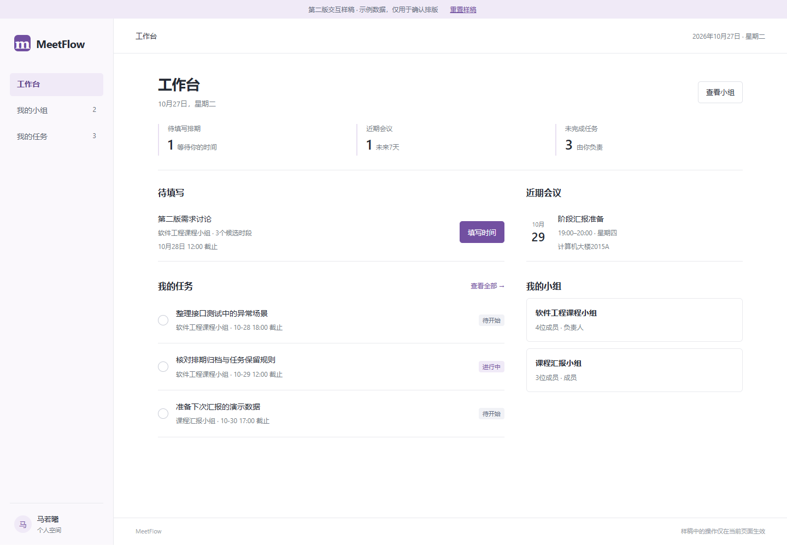
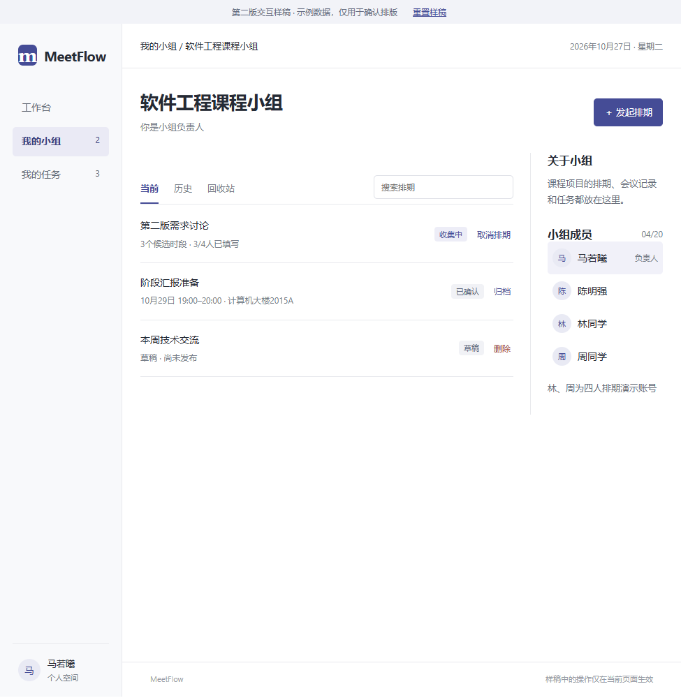
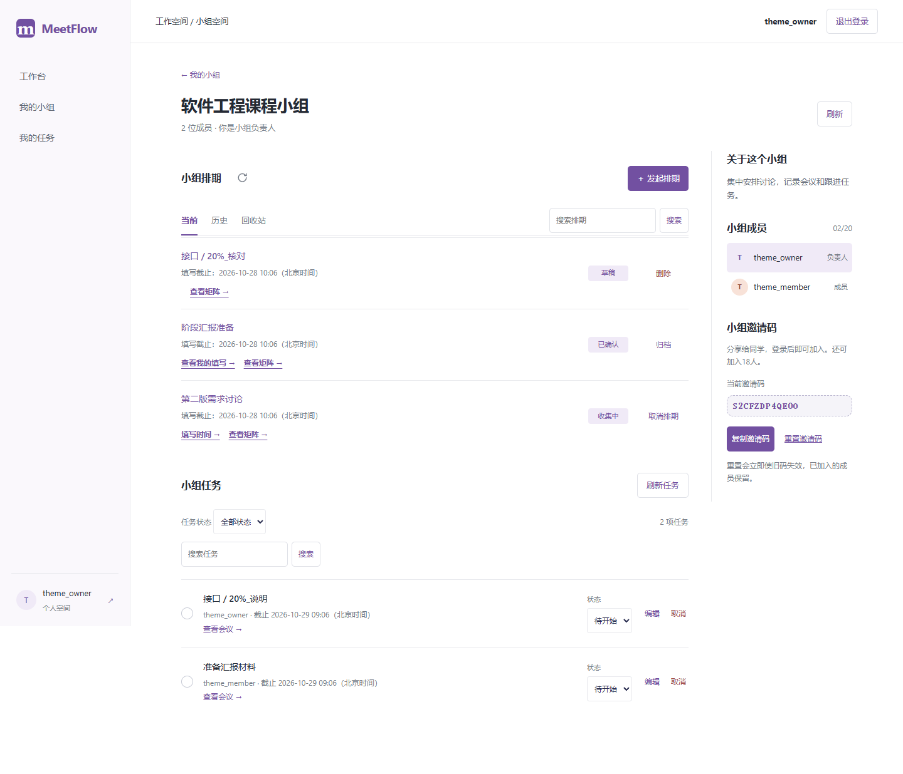
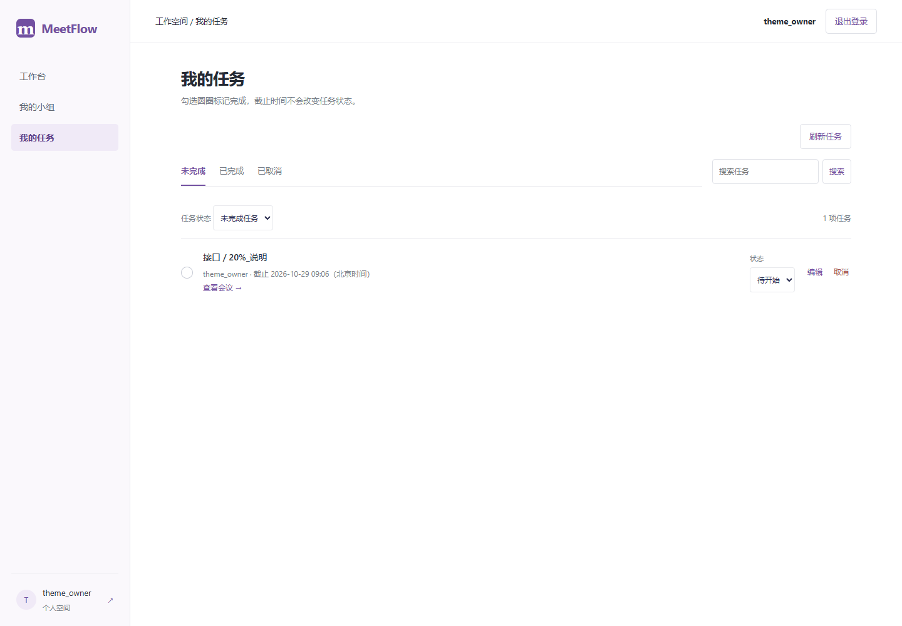

# 第二版界面样稿与确认记录

日期：2026-10-27。对应V2-02。状态：马若曦已认可排版，按反馈将主题色调为偏紫；正式Vue页面和接口尚未修改。

## 本次调整

采用白底、紧凑导航和分隔线列表，采用柔和紫色主操作（#7250A1）和浅紫选中/本人背景。去掉大面积紫色卡片、装饰英文及口号；常规正文14px、次要说明12px、页面标题26px（手机23px），系统中文无衬线字体，操作按钮至少40px高。状态用文字和颜色共同表达。

| 页面 | 主要内容 | 可检查的操作 |
| --- | --- | --- |
| 工作台 | 待填写、近期会议、本人任务与小组入口 | 三页导航，任务完成后数量同步 |
| 小组页 | 排期列表、当前/历史/回收站，右侧简介和成员 | 搜索、取消、归档、删除与恢复；操作前确认影响 |
| 我的任务 | 未完成/已完成/已取消，标题与截止 | 圆圈完成、重开、状态切换、编辑、取消与恢复 |

样稿使用固定日期和虚构业务样本；林、周为演示参与者，不代表增加了实际组员。仅在内存保存演示更改，刷新或重置会恢复。样稿以负责人身份展示，不执行服务端权限、截止或版本校验，不作为公网版本或功能验收结果。“发起排期”仅展示说明对话框；实际表单和会议详情仍沿用正式版，待本方向确认后改造。

## 预览与截图

在仓库根目录运行：

```powershell
Src/backend/.venv/Scripts/python.exe -m http.server 8768 --bind 127.0.0.1 --directory Src/v2-preview
```

打开[工作台](http://127.0.0.1:8768/#home)、[小组页](http://127.0.0.1:8768/#group)、[我的任务](http://127.0.0.1:8768/#tasks)。关闭预览服务可在运行窗口按Ctrl+C。该地址只供本机审阅。

| 工作台（桌面） | 小组页（窄窗口） | 任务（手机） |
| --- | --- | --- |
|  |  |  |

## 验证与暂停点

Chrome、Edge均验证1440、975、390像素宽的三页，无整页横向溢出；完成/重开、取消返回/恢复、编辑搜索、归档、删除恢复均通过，没有外部网络请求和页面脚本错误。截图已人工查看工作台桌面、小组窄窗口、任务手机布局；这不是用户验收或真实试用。

测试脚本：[check.mjs](../Src/v2-preview/check.mjs)，运行前通过PLAYWRIGHT_MODULE_PATH指定已有Playwright模块；MEETFLOW_BROWSER_CHANNEL可设chrome或msedge。原始结果：[Chrome](evidence/v2-02-chrome.json)、[Edge](evidence/v2-02-msedge.json)。截图为最后一次Edge运行生成。

V2-01已完成；V2-02排版已获马若曦认可，本次按反馈调整为紫色主题。正式页面后续沿用该方向；本次只调整样稿配色。V2-03及以后尚未执行，人工试用仍待人工执行。

补充反馈：排期列表的状态和操作采用固定宽度两列，各行居中对齐；手机把说明独立一行，状态与操作仍按列对齐。双浏览器增加1440、975、390宽度的列坐标和行内垂直居中检查。


## 用户再次指定的样稿（2026-10-28）

马若曦通过引用“已改成更偏紫的主题，按钮、选中项、头像和本人背景都统一了”明确选择本文件对应的V2-02样稿，而非第一版旧页面。以Src/v2-preview现存文件为对照，配色提交为a60eab3，随后5009a8d调整状态和操作列对齐。样稿自身保持不变。

本次正式接入工作台、小组和我的任务：白底、208px侧栏、紫色#7250A1、浅紫#F0EAF7、14px正文和列表分隔线；小组说明及成员在右侧，手机为单列；个人任务增加未完成/已完成/已取消分类。保留真实接口、权限校验、手动完成、搜索、详细状态筛选、邀请码和刷新入口，不添加样稿虚构数据。正式页的登录、投票、矩阵和会议页仍用已有布局，避免再次扩大全站改动范围。

样稿样式映射集中在Src/frontend/src/sample-layout.css，以sample-shell限定范围。不得再把第一版还原当作本样稿。2026-10-28前一次恢复及其截图仅为过程记录，本次用户指定覆盖该方向。

本次验证：前端310项、正式构建及文档38项检查通过；Chrome九组既有交互回归通过，Chrome/Edge均通过样稿配色、208px侧栏、成员右栏、任务分类、搜索及1440/390宽度检查，查看截图确认三页布局。相关证据：[Chrome](evidence/purple-sample-chrome.json)、[Edge](evidence/purple-sample-msedge.json)、[完整交互回归](evidence/purple-sample-acceptance-chrome.json)。

| 正式小组页 | 正式任务页 |
| --- | --- |
|  |  |

三页接入待用户实际检查，不将自动化通过记为人工认可。
