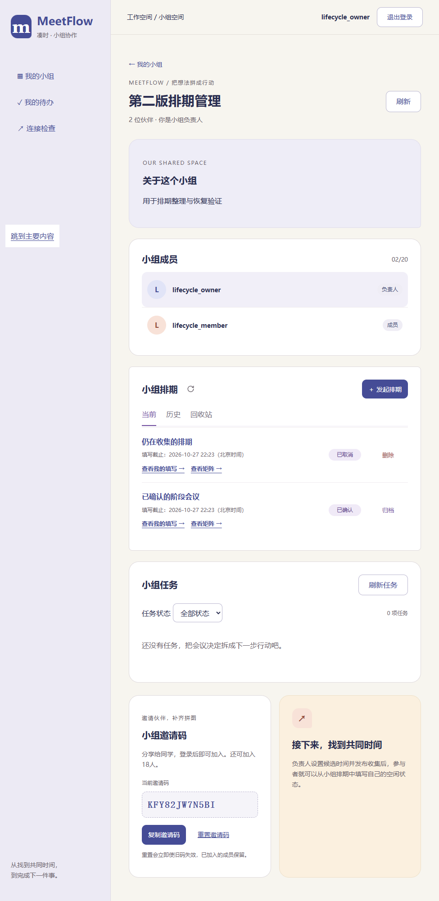

# 排期删除、归档与恢复验证

日期：2026-10-27。V2-04设计已形成；V2-05排期迁移部分、V2-06/07接口已完成，V2-08页面已实现，等待用户排版确认。任务表增强迁移仍待V2-09/10，不提前标为V2-05全部完成。

## 已实现规则

负责人可删除草稿、已关闭且无会议、已取消排期；收集中先取消。删除只设置标记，不清除时段、参与者或答案。回收站仅负责人可见；恢复保持原业务状态，不重新开始收集。已确认排期只能归档或取消归档，会议与未完成任务继续可访问。

新增0006_poll_lifecycle；两个可空标记及数据库约束、索引通过原生ADD COLUMN加入，不重建有外键引用的排期父表。普通详情、答案、矩阵、推荐及确认均隐藏已删除排期。删除与会议确认共用BEGIN IMMEDIATE锁，竞争时只允许一方成功。重复同操作保留原结果和时间。

页面增加当前/历史/回收站，状态与操作按两列对齐。成员隐藏管理操作和回收站；服务端仍检查权限。每次操作前说明影响，返回不写入；请求结果未确认时保留旧列表并禁用写操作，通过读取核对，不自动重发。历史与回收站按服务端过滤和分页，回收站不提供失效详情入口。全站紧凑主题改造留在V2-15，本次只接入排期管理区。

## 验证结果

- 后端全量592项通过（267.70秒），新增15项覆盖删除恢复、关闭/取消规则、归档后会议与任务可达、权限、分页、确认竞争、数据库约束和旧库升级/失败回滚。
- 前端全量285项通过，TypeScript及正式构建通过，新增12项验证分类响应、请求不重试和不确定结果处理。
- Chrome、Edge真实页面通过删除/返回/恢复、归档/取消归档、响应丢失后只读核对、取消后删除、成员权限隐藏、1440/975/390视口列对齐与无整页横向溢出；使用隔离临时数据库。
- Edge回归排期编辑、空闲填写、矩阵与会议确认通过。发现旧填写测试只接受同日时间字符串，已调整为同时验证跨日日期格式；产品显示无需修改。
- 沙箱内测试进程未继续推进，已停止这些测试进程，改用本机隔离临时库完成全量测试。浏览器测试最初使用不被邮箱校验接受的.test样本域，已改为example.com后通过，不改变产品邮箱规则。

原始浏览器结果：[Chrome](evidence/v2-08-chrome.json)、[Edge](evidence/v2-08-msedge.json)。复现：后端运行`python -m pytest -q`；前端运行`npm test`、`npm run build`、`node browser.check.mjs --built --poll-lifecycle`，浏览器模块路径配置沿用现有工程。Edge使用PROTOTYPE_BROWSER=msedge。

## 本机升级与检查入口

已核对8000端口归属本仓库虚拟环境，停服后备份至`Src/backend/data/backups/pre-0006-20261027-212358.sqlite3`。升级后逐项核对原十张业务表全部旧字段与行：用户1、小组1、会话3、成员1、排期3、参与者3、时段5、答案3、会议1、任务1，全部一致；外键有效，未替用户删除或归档任何排期。

服务已重启，`/api/v1/health`返回ok。原[小组页面](http://127.0.0.1:8000/groups/1)可检查新操作，使用原账号登录。备份含本地数据，仅存于忽略目录，不提交仓库。

测试样本截图（不代表本机真实用户数据）：

按既有约定，在V2-08排版确认处暂停。V2-03免费平台仍待实际账户中的部署验证；公网网址、任务编辑取消与工作台尚未交付；五人真实试用继续待人工执行。
