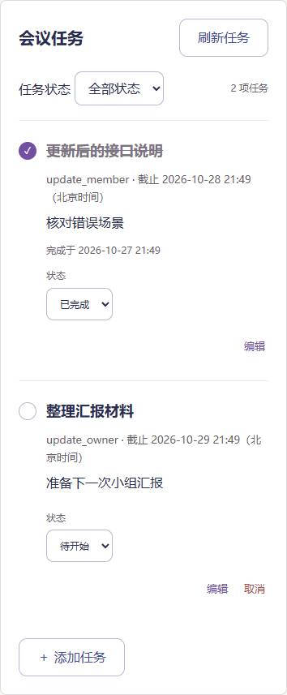
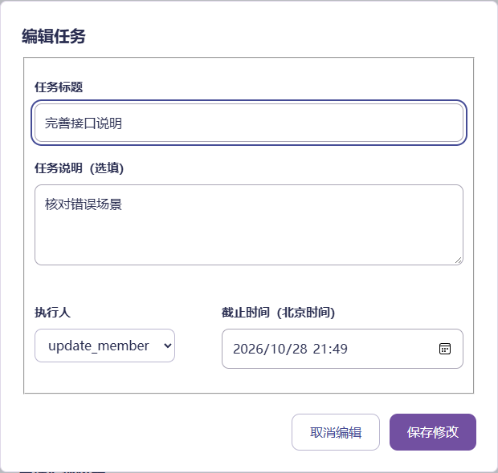

# 任务编辑、取消与完成验证

日期：2026-10-27。V2-05任务迁移部分、V2-09/10已完成；V2-11正式页面已接入，等待马若曦检查排版。免费部署、工作台和全站样式统一仍按后续任务推进，人工试用保持待执行。

## 功能规则

- 任务前的圆圈用于完成或重开；保留待开始/进行中/已完成下拉选择。截止或会议时间过去只表示逾期，不自动完成。
- 负责人可编辑标题、说明、组内执行人和截止。只提交实际改动的字段，未改动的截止保留原精度；原截止已过仍可改其他字段，主动修改截止须设置为未来。
- 负责人可取消任务，恢复固定为待开始；已完成任务须先重开才能取消。执行人可更新正常进度，不能取消/恢复或修改指派信息，普通成员只查看。
- 已完成和已取消均从默认个人待办隐藏，仍可按状态查看。取消不记录完成时间、不显示逾期；归档排期不影响未完成任务。
- 编辑和状态请求必须带expected_version。服务端在取得写锁、验证权限后检查版本；旧页面409，不覆盖新数据。相同版本的无变化操作不递增版本。
- 创建去重使用不可变的原始输入快照；后续编辑不影响原创建标识的重试。同一原始请求返回当前任务，改变原始创建输入仍409。客户端对版本1校验原创建字段；版本大于1的原请求重试允许返回已经编辑的当前内容，仍核对所属小组和会议。

## 数据与接口

0007_task_updates重建任务表约束并保留原索引、唯一及外键约束，增加version和creation_payload，回填原创建输入。原任务版本从1开始，状态、截止、执行人、说明及完成时间保持原样；不返回内部创建快照。

TaskOut增加version。PATCH `/tasks/{id}`接收expected_version及非空的部分基本字段；PATCH `/tasks/{id}/status`接收expected_version和四态status；未提供版本422。空编辑、显式null、非法成员/文本/时间拒绝。个人默认查询仅TODO、IN_PROGRESS；显式CANCELLED可查取消记录。实现沿用[46号设计](46-第二版部署探索与数据接口设计.md)。

创建重试和当前任务内容分离的快照属于本轮补充：若直接比较已经编辑的行，同一原请求会被错误判为另一任务，因此迁移时保存旧字段、创建时保存规范化输入、编辑时保持快照。

## 页面与异常处理

任务列表在会议、小组、个人待办共用。负责人在个人待办也可编辑自己的小组任务，角色从组接口读取，不凭“任务创建人”猜测。编辑前读取当前成员列表；只读成员没有管理入口，服务端仍验证权限。

编辑弹窗字段校验显示在输入下。保存期间禁止重复操作和关闭；409或响应丢失时保留输入并锁定写入，用户可核对保留的内容，关闭并刷新后基于最新任务再编辑。关闭有未保存修改的表单需要确认。状态操作失败保留原显示，通过只读请求核对，禁止自动重发写操作。取消/恢复先说明影响，再确认。

本次仅改任务区域，外层导航和其他卡片仍沿用第一版；全站紧凑紫色主题在V2-15统一。

## 验证结果

- 后端610项全量通过（307.20秒），新增18项覆盖编辑与指派权限、逾期不改截止、创建重试、取消恢复、版本冲突、并发编辑/状态竞争、非法字段，以及0006旧任务迁移、快照回填和失败回滚。
- 前端294项通过，TypeScript和Vite构建通过；补充9项版本请求、非法快照、取消筛选、部分编辑和创建重试契约测试。
- Chrome、Edge通过编辑/取消/恢复、执行人完成重开、并发编辑保留输入、响应丢失只读核对、普通成员只读、1440/975/390宽度无整页横向溢出，以及编辑弹窗桌面/手机边界检查。
- Chrome回归原任务创建、去重、分页、筛选和异常核对；Edge四个独立会话的完整UI流程通过。初次新浏览器测试在重开后仍停留“已完成”筛选，无法找到未完成任务，已修正测试切回未完成；未改产品规则。

原始记录：[Chrome](evidence/v2-11-chrome.json)、[Edge](evidence/v2-11-msedge.json)、[四账号回归](evidence/v2-11-e2e.json)。第一版t36证据原样保留，新增回归单独记录；这些不是人工易用性试用记录。

复现：后端`python -m pytest -q`；前端`npm test`、`npm run build`、`node browser.check.mjs --built --task-updates`。Playwright路径配置沿用工程说明，Edge设PROTOTYPE_BROWSER=msedge。

| 手机任务区 | 桌面编辑弹窗 |
| --- | --- |
|  |  |

## 本机升级与确认入口

停服前核对进程属于本仓库虚拟环境；备份保存在`Src/backend/data/backups/pre-0007-20261027-214736.sqlite3`，仅本机保留。升级前后核对原十张业务表全部旧字段与行一致：用户1、小组1、会话4、成员1、排期3、参与者3、时段5、答案3、会议1、任务1。外键有效，现有任务初始化版本及创建快照，无实际任务状态改动。

服务使用原8000地址重启。可在[会议页](http://127.0.0.1:8000/meetings/1)和[我的待办](http://127.0.0.1:8000/tasks/mine)检查新入口。按照约定在V2-11排版确认处暂停，确认后继续V2-12工作台接口及后续页面。

后续确认：马若曦认可任务区域，并要求移除“任务状态已保存。”提示块。已移除并更新回归，以实际任务状态和列表结果验证保存；V2-11排版确认完成。
