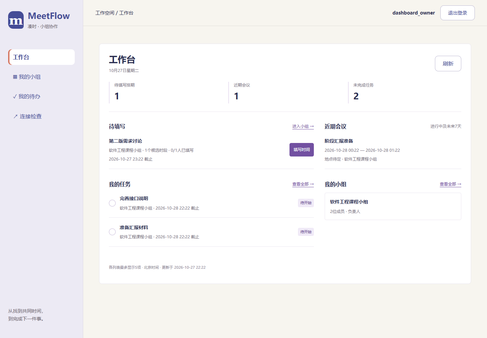
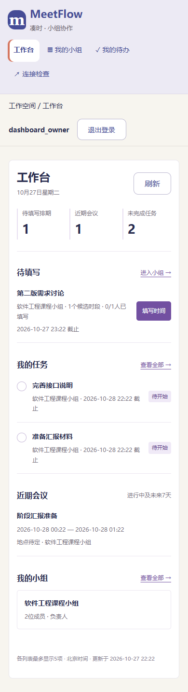

# 工作台汇总与页面验证

日期：2026-10-27。任务区域按反馈移除状态保存提示，V2-11已确认。V2-12工作台接口已完成，V2-13正式页面已接入，等待用户检查排版。

## 汇总口径

工作台只汇总当前登录用户的事项：

- 待填写：本人被选为参与者、尚未提交、仍在收集且服务端时间未到截止，排除删除和归档。按截止、ID升序展示。
- 近期会议：本人参与的会议，包含进行中和未来7天内开始的会议（开始时间小于现在加7天，结束时间晚于现在）。普通组员虽然可查看同组会议，但没有被选为参与者时不计入个人近期安排。归档不取消参会安排。
- 未完成任务：本人负责且为待开始/进行中，逾期仍保留，已完成和已取消不计入。归档不移除任务。按截止、ID升序展示。
- 我的小组：本人已加入的小组，按创建时间、ID降序；不返回邀请码。其他三类事项同样要求当前小组成员关系。

每类返回准确总数及最多5项预览，页面提供进入小组、会议和全部任务的入口。此处不是完整分页列表，不把预览条数当总数。

## 接口和页面

GET `/api/v1/dashboard`使用原会话认证与no-store响应。单个只读事务读取四类数据，在首个数据读取之后采样服务端时间，统计和列表来自同一数据库快照。没有后台计时器、额外缓存、数据库迁移或新依赖。

页面新增`/dashboard`，根地址、品牌链接与无有效返回地址的登录默认进入工作台；有效的原返回地址保持原样，登录后继续回到原任务。侧栏新增工作台入口。按钮、列表使用紫色主题与分隔线，手机单列；其他旧页面和侧栏的整体整理仍在V2-15完成。

任务可直接勾选完成，成功后刷新四类汇总，不显示成功提示块。失败保留旧数据并禁用写操作，通过刷新核对；首次读取失败不伪装成零项。初始加载、空数据、旧数据和错误分别展示。用户切换身份后沿用现有路由实例隔离，清除旧用户界面。

## 验证

- 后端618项全量通过（309.09秒），新增8项验证未登录/空数据、待填写与截止、私有小组和非参与者隔离、删除取消排除、归档与进行中会议、完成取消任务排除，以及总数与5项限制。
- 前端306项通过，TypeScript及正式构建通过。新增工作台契约测试和路由检查，覆盖缺失数据、非法时间/人数、列表不完整、重复ID和错误执行人。
- Chrome、Edge检查真实汇总数量、填写入口、完成后的计数和列表、无成功提示、503保留旧结果、初始失败不显示假零、非参与者和组外隔离，1440/975/390宽度均无整页横向溢出。
- Chrome登录/注册/安全返回/会话恢复流程通过；Edge四账号完整UI流程通过，更新到工作台登录入口后继续完成建组、排期、会议和任务。
- 通用浏览器检查原先假定根地址是小组页、请求清单没有dashboard；已随新入口更新。品牌链接和导航都进入工作台，测试定位限定在主导航，避免同时匹配两者。这些属于验证脚本适配。

原始结果：[Chrome](evidence/v2-13-chrome.json)、[Edge](evidence/v2-13-msedge.json)、[四账号回归](evidence/v2-13-e2e.json)。自动化与人工试用分开，五人真实记录仍待人工执行。

复现：后端`python -m pytest -q`；前端`npm test`、`npm run build`、`node browser.check.mjs --built --dashboard`。Playwright路径沿用工程配置，Edge设PROTOTYPE_BROWSER=msedge。

| 桌面工作台 | 手机工作台 |
| --- | --- |
|  |  |

## 本机与交接

服务已重启载入接口，数据库仍为0007，没有新增样例或改动真实业务数据。打开[工作台](http://127.0.0.1:8000/dashboard)检查；没有当前事项时显示实际空状态，截图中的有数据场景来自隔离测试库。

按照约定在V2-13排版确认处暂停。后续继续V2-14搜索筛选与V2-15全站视觉整理；免费公网部署仍需平台实际账号验证，人工试用不冒充完成。
