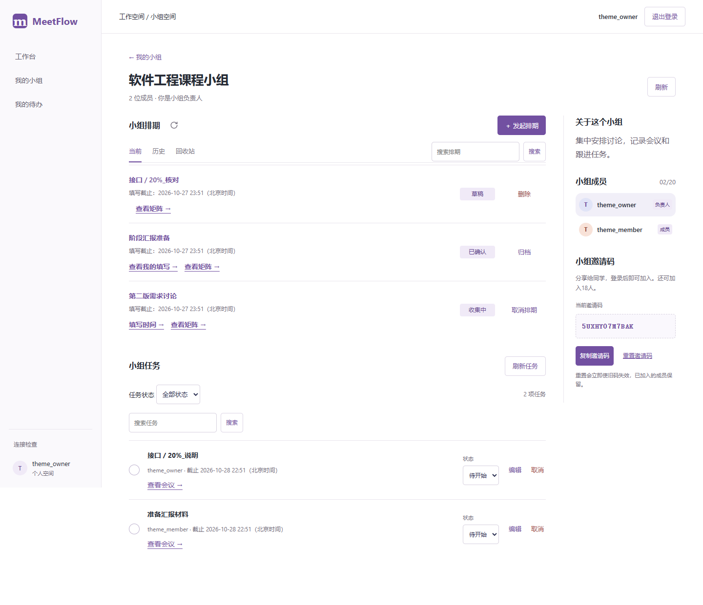
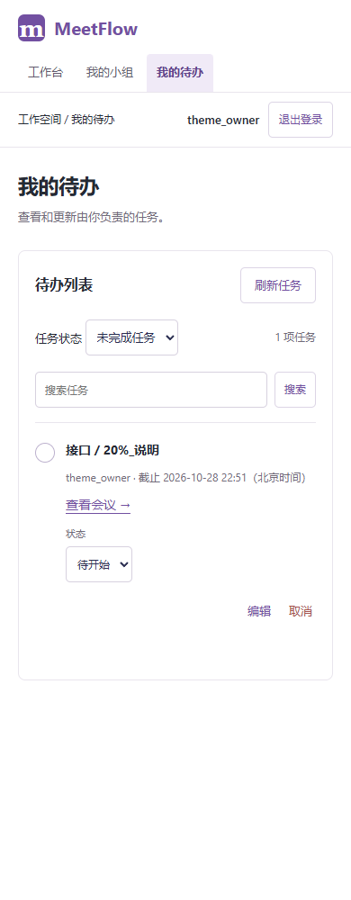
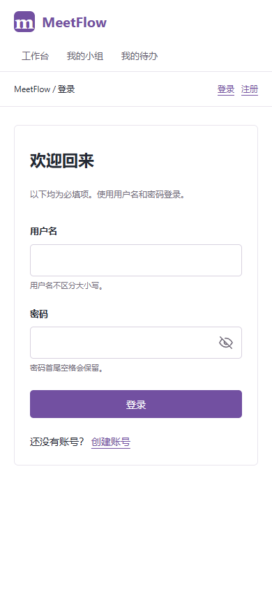

# 搜索筛选与全站界面整理

日期：2026-10-27。V2-13工作台排版已确认，V2-14搜索筛选完成；V2-15已接入正式页面并通过自动验证，等待用户整体排版确认。

## 搜索与筛选

小组排期按标题搜索，可与当前/历史/回收站组合；小组、会议及个人任务按标题搜索，可与状态及会议范围组合。点击搜索或按Enter提交，清除恢复原范围；切换分类保留已应用的关键字，搜索从第1页开始。

服务端先做身份、成员关系、对象和状态过滤，再按标题包含匹配，最后计数与分页；不会只过滤已加载的一页。q最多100个有效字符、首尾空白去除，空白等同无搜索。SQL通配符%、_及转义字符作为普通文字，不展开模式；NUL和超长输入422拒绝。

前端显示当前已应用的关键字；请求失败保留原列表和原搜索条件，并禁用依赖成功读取的写操作。重新读取核对原结果，避免把搜索失败显示为空列表。

接口保持原路径及默认行为，仅新增q查询参数。客户端把URL路径和查询分开校验：路径仍禁止编码路径和穿越，已编码的斜线、百分号、空格等只作为查询数据发送。因此可搜索“接口 / 20%_”，不会误触发路径检查或访问外部站点。

## 界面整理

- 全站采用白底、紧凑侧栏、紫色主操作和少量浅紫背景；统一系统中文无衬线字体、14px基础正文、16px区块标题、26px页面标题（手机23px），保留小组说明16px。
- 小组页左侧为排期和任务，右侧为说明、成员和邀请码；窄屏单列。保留负责人优先、本人浅色背景、容量小字和排期状态/操作两列。
- 缩小圆角与留白，用分隔线替代重复的大卡片。去除装饰英文、口号、时间拼块和重复引导；登录聚焦表单。错误、权限、截止及未确认保存等必要说明保留。
- 工作台、登录、小组、排期编辑、三态填写、矩阵、推荐、会议和任务使用同一主题；主要按钮与搜索、筛选控件至少40px高，完成圆圈通过扩展点击区域保留操作面积。
- 表格内部横向滚动、表单校验、焦点和键盘三态选择继续保留，不以视觉简化替代业务反馈。

主题覆盖集中在`Src/frontend/src/theme.css`，保留业务组件样式，减少后续改色与间距时逐页修改。当前成员浅色背景、必到标记及说明字号等已确认细节继续通过回归检查。

## 验证

后端629项全量通过（319.00秒），新增11项覆盖搜索分页总数、清除、分类与权限、特殊字符、任务状态/执行人/会议组合、非法搜索输入。前端310项通过，新增4项校验合法查询编码与非法路径/查询拒绝；正式构建通过。

Chrome、Edge均完成九组既有UI回归：认证、小组、排期编辑、三态填写、矩阵、推荐、会议确认、纪要和任务。新检查覆盖特殊字符搜索、当前/历史与关键字组合、清除、搜索失败保留原结果、任务从第二页搜索重置到第一页、成员右侧布局、六页1440/390宽度、手机登录及任务编辑弹窗，无整页横向溢出。

整理时曾把小组说明缩至14px，旧回归及时指出，已恢复用户确认的16px；初始空小组文案变更为“尚未加入小组”，对应测试随之更新。最终截图由最近一次Edge新检查生成，既有完整回归结果单独保存，不覆盖第一版证据。

原始结果：[Chrome新检查](evidence/v2-15-chrome.json)、[Edge新检查](evidence/v2-15-msedge.json)、[Chrome完整回归](evidence/v2-15-acceptance-chrome.json)、[Edge完整回归](evidence/v2-15-acceptance-msedge.json)。

复现：后端`python -m pytest -q`；前端`npm test`、`npm run build`；完整浏览器检查`node browser.check.mjs --built --search-theme --acceptance`。Playwright路径沿用工程配置，Edge设置PROTOTYPE_BROWSER=msedge。测试使用隔离临时库；截图为示例账号，不是人工试用记录。

| 小组桌面 | 手机任务 | 手机登录 |
| --- | --- | --- |
|  |  |  |

## 本机与交接

服务已重启载入搜索接口，无数据库迁移或实际业务数据修改，数据库仍为0007。可检查[小组页](http://127.0.0.1:8000/groups/1)、[工作台](http://127.0.0.1:8000/dashboard)和[我的待办](http://127.0.0.1:8000/tasks/mine)。现有待办为空时按真实状态展示，不为审阅添加假数据。

按约定在V2-15整体排版确认处暂停。V2-03免费平台实测及后续公网账户防护、找回密码、发布恢复等尚未交付；五人真实试用继续待人工执行。

## 界面恢复（2026-10-28）

用户明确不接受V2-15紧凑全站主题，恢复11d12c6版本已认可的配色、字号、侧栏、卡片及小组内容顺序。撤回theme.css覆盖，保留V2-14搜索及已有工作台、任务和排期功能；搜索样式仅作用于新增搜索控件。此前截图和验证保留为历史记录，不代表用户认可。后续界面调整先提供具体改动范围，不再整站替换。恢复后的自动检查记录见evidence/ui-restored-*.json，五人真实试用仍待人工执行。

恢复验证：前端310项测试、正式构建、文档38项检查通过。Chrome九组既有UI回归与搜索检查通过；Edge搜索与恢复布局检查通过，覆盖1440/390宽度、手机登录与任务编辑弹窗。核对截图确认已恢复原小组布局。后端未改动，无数据库迁移。

[Chrome回归](evidence/ui-restored-acceptance-chrome.json)、[Chrome恢复检查](evidence/ui-restored-chrome.json)、[Edge恢复检查](evidence/ui-restored-msedge.json)、[恢复后小组截图](images/ui-restored/group-1440.png)。
