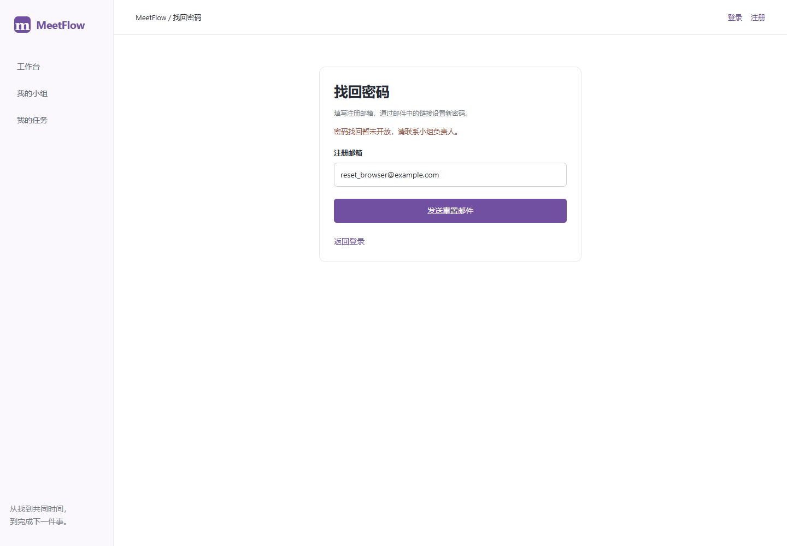
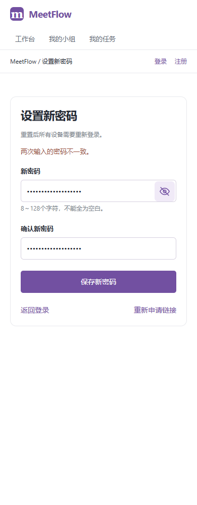

# 本地发布准备与账户防护

日期：2026-10-28。V2-15排版已获认可；用户要求继续开发，且暂无托管平台账号，先完成本地发布准备。本文记录V2-16～19的本地实现和验证；不代表已上线，也不代表邮件已经送达真实收件箱。

## 公网配置与账户防护（V2-16）

默认local/test继续只绑定127.0.0.1。production必须显式配置固定HTTPS public_origin和独立于开发库的数据目录，才能选择公网监听。Host只接受配置的站点；HTTP请求拒绝，浏览器来源继续按同源检查，不开放跨域。

只有明确列出的代理IP或网段才交由Uvicorn解释转发头；默认不信任代理，拒绝通配和整个地址空间。客户端自行填写X-Forwarded-For不能改变限流身份。代理配置必须在选定平台后按实际拓扑验证，不能把本机测试当成平台验证。

公网会话Cookie启用Secure、HttpOnly、SameSite=strict；退出删除Cookie使用相同属性。API响应不缓存，启用防嗅探、防嵌入、来源策略及生产CSP/HSTS。请求日志继续只记录服务端请求编号、路由模板、状态和耗时，拒绝将密码、邮箱、查询参数、令牌或异常原文写入应用日志。平台自身访问日志仍需上线时单独核对。

公网按可信连接IP限流：登录10次/分钟、注册5次/小时、找回申请5次/小时、重置确认10次/分钟；成功和失败都计入。超限返回429及Retry-After，不影响普通读取。限流只适用于单进程，最多10000个活动键，满额时拒绝新键，过期后恢复；重启会清空，不能宣称可抵御分布式攻击或支持多实例。

## 密码找回（V2-17～18）

| 接口 | 行为 |
| --- | --- |
| POST /api/v1/auth/password-reset/request | email，已注册/未注册均返回相同202文案；邮件未配置统一503，不伪报发送 |
| POST /api/v1/auth/password-reset/confirm | token、password；成功200，失效/过期/已用统一400，字段错误422 |

新增0008_password_resets迁移，仅增加重置摘要表及索引，不改既有业务行。链接15分钟有效、单次使用；同一账号60秒内重复申请不重复发信，新链接作废旧链接。原始随机令牌只用于邮件，不入库，库内存SHA-256摘要。事务内更新密码、作废该账号全部未用链接并撤销全部旧会话；并发使用只允许一次成功。登录在生成会话前再次核对密码摘要，防止旧密码校验与改密交错后产生新会话。

邮件通过证书校验的SMTP_SSL发送，配置见[环境模板](../Src/backend/.env.example)。后台发送失败只记固定错误码，避免输出收件人、密码和令牌。发送队列为进程内背景任务，不保证进程崩溃后的投递；用户可稍后重新申请，真实邮件送达与平台出站权限仍待验证。

登录增加“忘记密码？”入口；[申请页](http://127.0.0.1:8000/forgot-password)校验注册邮箱，[重置页](http://127.0.0.1:8000/reset-password)校验新密码及二次确认。邮件令牌放URL片段，页面接收后从地址栏移除，只保存在当前组件内；重新加载需重新打开邮件链接。支持同一标签打开另一条链接，完成后清空密码，离开清空输入。提交响应丢失时提示核对，不自动重试或假报成功。未配置SMTP时本机申请页会明确提示暂未开放。

## 备份、恢复与更新（V2-19本地准备）

在Src/backend运行，路径替换成实际位置；备份包含用户私密业务数据，保存在仓库外或已忽略的数据目录。

```powershell
.venv/Scripts/python.exe -m app.db.backup create data/meetflow.sqlite3 data/backups/before-update.sqlite3
.venv/Scripts/python.exe -m app.db.backup restore data/backups/before-update.sqlite3 data/recovered-new
```

create使用SQLite备份API生成一致快照，检查完整性、外键及版本表。已有目标文件或链接一律不覆盖。restore必须使用尚不存在的新目录，验证后清除恢复库的旧会话和重置链接，原库与当前服务配置不变；损坏源失败不留下恢复目录。

更新顺序：保存当前代码版本与已验证备份 → 安装锁定依赖和构建前端 → 停止该实例 → 显式迁移 → 启动单进程服务 → 检查健康、深链接和登录及业务读取。失败时停止新实例，恢复备份到新目录，配合备份对应的旧代码和前端构建，将data_dir指向恢复目录后启动；不要用有损降级、覆盖正在使用的SQLite文件或只复制主库而忽略事务日志。

生产配置从[环境模板](../Src/backend/.env.example)的注释段复制到平台私密配置。生产数据目录须独立，不上传本机开发数据库和演示账号。暂未选定平台时不要取消本机绑定保护。

## 验证与剩余事项

后端检查覆盖配置失败封闭、Host/来源/HTTPS、Secure Cookie、代理信任、限流窗口/容量、日志脱敏、重置失效/过期/重复/并发及会话撤销、SMTP模拟失败、备份恢复和旧版迁移。前端检查涵盖字段和请求体、密码不进入URL；浏览器使用隔离临时库生成真实测试令牌验证改密，未发送真实邮件。最终执行结果在本文末节补充。

V2-03平台最小实例、持久存储重启、代理拓扑及真实邮件尚待有账号后实测；V2-21外网发布、V2-22实际网址交付和V2-23真实人工试用仍待执行。V2-20只可记录本地回归，不能冒充公网验收。真实试用继续按用户要求待人工执行。

免费候选复核：PythonAnywhere官方仍说明ASGI为实验功能，免费计划列出512MiB、1个worker及1个月web app到期，具体ASGI额度、邮件出站及运行限制需账号实测。[ASGI说明](https://help.pythonanywhere.com/pages/ASGICommandLine/)、[免费计划](https://help.pythonanywhere.com/pages/FreeAccountsFeatures/)（核对2026-10-28）。

### 本轮最终结果

- 后端全量658项通过（350.25秒）；随后新增旧密码登录与改密并发保护，认证/重置/公网防护/备份75项专项通过（19.25秒），包含新增并发回归。
- 前端313项通过，正式构建通过。Chrome完成九组既有交互回归；Chrome、Edge均完成找回密码真实测试令牌、改密、重复链接、丢失响应、会话失效及1440/390宽度检查。邮件传输为模拟，不是实际送达记录。
- 本机先备份再升级至0008_password_resets，原十张业务表逐行一致，恢复演练写入独立目录且撤销旧会话，健康检查通过。本机仍绑定127.0.0.1。备份位于已忽略的data/backups/pre-0008-20261028-0949.sqlite3，恢复演练目录为data/rehearsal-0008-20261028；不提交真实数据。

原始结果：[Chrome新增流程](evidence/password-reset-chrome.json)、[Edge新增流程](evidence/password-reset-msedge.json)、[Chrome既有回归](evidence/local-release-acceptance-chrome.json)、[本机升级与恢复](evidence/local-release-upgrade.json)。

| 申请页面 | 手机重置页面 |
| --- | --- |
|  |  |

复现：后端python -m pytest -q；前端npm test、npm run build；浏览器node browser.check.mjs --built --password-reset --acceptance，Edge设置PROTOTYPE_BROWSER=msedge。使用工程现有Playwright路径和虚拟环境，浏览器用临时数据库，测试令牌不用于真实账号。

## 新版丰富演示（2026-10-28）

用户要求把旧样稿中的虚拟排期和任务补到新版。新增app.demo的--showcase选项，在全新独立目录创建2个小组、9个排期、3场会议和10项任务，包含待填写、关键成员未填、全部必到冲突、草稿、取消、归档和回收站；任务包括待开始、进行中、已完成和已取消，并展示归档会议下仍需跟进的任务。使用正常业务服务生成，保留原基础演示模式；拒绝已有目录及production配置，不向8000的真实库插入示例。

当前演示：[登录](http://localhost:8001/login)、[工作台](http://localhost:8001/dashboard)。账号demo_owner，演示密码MeetFlowDemo2026!；成员demo_member1～demo_member3使用相同演示密码。演示账号与数据全为虚构，仅用于本机，禁止用于公网生产账号。工作台当前有1个待填写排期、3场近期会议和4项本人未完成任务。示例日期相对于生成时间，长期放置后排期会自然截止。

原正式本机仍是127.0.0.1:8000；演示使用localhost主机名，使两边登录Cookie隔离。旧8768仍为静态样稿，新8001使用正式前后端和独立数据库，可实际保存状态。演示库位于忽略目录data/showcase-20261028。

重新生成时先选一个不存在的新目录，不删除或覆盖旧目录。仓库根目录运行：

```powershell
Src/backend/.venv/Scripts/python.exe -m app.demo --data-dir D:/软件工程/Src/backend/data/showcase-new --showcase
$env:MEETFLOW_DATA_DIR='D:/软件工程/Src/backend/data/showcase-new'
$env:MEETFLOW_PORT='8001'
# 在Src/backend下用python -m app启动，并确保该演示端口未被占用。
```

验证：演示5项后端测试通过；真实演示Chrome检查包括登录、工作台计数、历史/回收站、已完成/已取消筛选以及1440/390宽度。浏览器检查用node showcase.browser.mjs，沿用工程Playwright配置。[检查结果](evidence/v2-showcase-chrome.json)、[工作台截图](images/v2-showcase/dashboard-1440.png)。不把演示验证当成人工试用。

后续先由用户自行注册[PythonAnywhere免费账号](https://www.pythonanywhere.com/registration/register/beginner/)，按页面提示完成账号验证；只需提供用户名，不发送密码或API令牌。之后验证最小ASGI实例、HTTPS和持久数据重启，再接入完整应用与真实邮件；免费ASGI能力仍需按账号实际条件核对。
