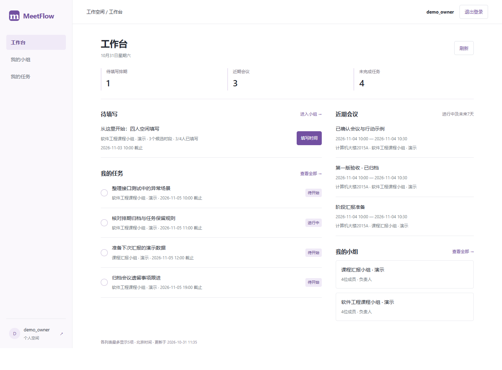
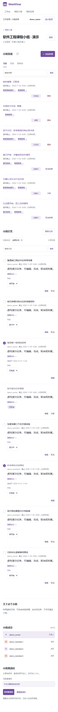

# 本地展示操作与封版记录

日期：2026-10-31。本次准备展示日为2026-11-02；PPT按用户安排11月2日制作，本文件先准备本地操作和截图，不虚报汇报已完成。

## 打开与停止

本机新演示已运行在[localhost:8002](http://localhost:8002/login)。负责人账号`demo_owner`，虚构演示密码`MeetFlowDemo2026!`；`demo_member1`至`demo_member3`使用同一演示密码。均为虚构演示账号，不用于公网或真实账户。

以后双击仓库根目录的[启动演示.cmd](../启动演示.cmd)，保留启动窗口，再打开上述地址。Ctrl+C停止该窗口启动的演示服务；已保存的数据不会清空。若提示端口被占用，先尝试打开现有地址，不重复启动，也不停止不明进程。

入口选择最近一次尚未过展示日的、带有效标记的独立演示目录；没有可复用目录才准备后天的演示。10月31日、11月1日及11月2日会复用本次`data/showcase-for-2026-11-02`。展示日之后不删除旧库，而是创建另一日期的独立库。固定选择本次数据时，在仓库根目录运行：

```powershell
Src/backend/.venv/Scripts/python.exe Src/scripts/run_showcase.py --presentation-date 2026-11-02
```

这条固定日期命令只用于展示日之前或当天。日期已过去时会拒绝继续；演示日期不是冻结系统时间，账号创建、真实完成时间等仍用实际时钟。

原真实服务`127.0.0.1:8000`和旧演示`localhost:8001`保持原样。新演示仅绑定本机地址，不需要网络和PythonAnywhere；首次安装依赖除外。本机已装好依赖和构建文件，换电脑仍需按[安装说明](42-本地安装与独立演示.md)准备。

## 建议展示顺序（约6～8分钟）

| 顺序 | 打开的页面与操作 | 讲述重点 |
| --- | --- | --- |
| 1 | 登录并打开工作台 | 约时间之后，还要把讨论落实为负责人、截止和任务状态。初始工作台有1个待填排期、3场近期会议、4项本人未完成任务 |
| 2 | 进入软件工程演示小组，打开“接口评审：关键成员尚未填写”的结果 | 未填是未知，不能当有空；必到成员缺答需要明确提示 |
| 3 | 打开“技术讨论：所有候选均有必到冲突” | 第一名不等于可直接开会；排名给出比较依据，风险仍需要负责人判断 |
| 4 | 打开“从这里开始：四人空闲填写”，填写三个候选为勉强、有空、没空，保存后看结果 | 三态填写、提交进度、时间矩阵和推荐理由；其他三位虚构成员已预填，第二候选会形成共同有空 |
| 5 | 负责人结束收集，确认第二候选，进入会议 | 确认生成会议，重复确认不会重复创建；议程和纪要保留讨论决定 |
| 6 | 创建一项由demo_owner负责的新任务，截止设置在未来；在“我的任务”勾选完成，再查看已完成分类 | 完成是明确操作，记录实际完成时间；会议结束或任务截止不会自动等于完成 |
| 7 | 回小组展示历史、回收站，再回任务列表 | 无效排期可整理；已确认会议用归档，历史中的记录和未完成任务继续可达 |

第4步之后会实际保存进度，待填计数自然变化，不再强求初始计数。重新排练可另建草稿，不删除或覆盖现有演示库。第6步的新任务使用未来截止，不要照抄即将过期的截图时间。演示时的四人是虚拟账号，项目实际组员仍只有马若曦和陈明强。

## 数据与回退

当前展示库：`Src/backend/data/showcase-for-2026-11-02/meetflow.sqlite3`，与真实库分开。初始数据2组、9排期、3场会议、10项任务；填写截止为11月3日10:00（北京时间），11月2日晚仍能操作。会议候选从11月4日10:00开始，任务截止从11月5日10:00开始。后台没有冻结系统时钟，也没有把数据库创建记录伪造到展示日。

同一日期重复启动会保留进度；未知目录、损坏标记、缺失数据库或生产配置不会触发自动覆盖。若要恢复备份，应恢复到新目录并显式切换服务，按[51号恢复步骤](51-本地发布准备与账户防护.md)处理，不覆盖运行中的SQLite文件。

## 本轮实际验证

- 展示日期和安全边界9项后端专项通过，包含展示日晚间待填仍存在、实际创建时间不变、错误日期不生成目录、原库不被覆盖。
- 启动器与仓库检查45项通过，覆盖生产配置隔离、未知目录拒绝、种子失败不写有效标记、同日期重复使用保留变更、跨天复用同次展示。
- 新演示真实登录、工作台计数、历史/回收站、已完成/已取消分类及1440/390宽度检查通过；保留新截图，不覆盖此前10月28日演示记录。[结果](evidence/local-rehearsal-chrome.json)。
- 四个独立浏览器会话在临时库完成从入组到任务状态回读的完整业务链；注册准备使用API，后续业务使用UI。不是四位真人试用。[流程结果](evidence/local-rehearsal-e2e.json)。
- 全量回归发现并修复历史测试夹具的日期耦合：固定到期时间随真实日期推进，早于会话创建时间，触发约束；只对齐测试会话的创建/到期时间，生产会话逻辑未改。修复后后端全量679项通过（353.70秒），脚本与仓库45项通过。[本轮结果](evidence/local-rehearsal-release.json)。
- 已实际停止并重新启动本轮8002演示，默认入口复用11月2日数据，库文件逐字节一致，4账号/2组/9排期/3会议/10任务保持不变。端口占用测试未改写数据库；已生成并校验初始快照`data/backups/showcase-20261102-initial.sqlite3`。[重启记录](evidence/local-rehearsal-restart.json)。

| 工作台桌面截图 | 小组窄屏截图 |
| --- | --- |
|  |  |

## 交付边界

公网部署未验收，真实邮件未验证，五人易用性试用待人工执行。这些在PPT中应放入限制和后续计划，不能把自动化测试人数当作真人试用人数。界面沿用已认可紫色版本，本轮没有整站换样式。
